# 框架图与核心机制图

本文用 Mermaid 绘制，GitHub、IDEA、VS Code 都能直接渲染。图只是概览，规则以各设计文档为准，图中标注了对应章节。

| 类别 | 图 |
|---|---|
| 框架图 | [1. 三方职责与整体架构](#1-三方职责与整体架构) · [2. 运行期调用关系](#2-运行期调用关系) · [3. 核心配置与编译配置](#3-核心配置与编译配置) |
| 核心机制图 | [4. 构建流水线](#4-构建流水线) · [5. 自动检测](#5-自动检测) · [6. 状态推进与完成判定](#6-状态推进与完成判定) · [7. checkpoint 状态机](#7-checkpoint-状态机) · [8. 会话内容组成](#8-会话内容组成) · [9. 知识模块](#9-知识模块) · [10. 多插件隔离](#10-多插件隔离) · [11. 看板事件推送](#11-看板事件推送) |

---

## 一、框架图

### 1. 三方职责与整体架构

上面一行是开发期：插件开发者写核心配置和技能资源，脚手架检测并编译，生成插件。下面一行是运行期：DevClaw 读取看板配置、调用插件入口、拉起会话，模型执行技能并通过 `update_state.py` 提交状态。两条线汇合到同一个插件。见 [README §1、§3](README.md)。

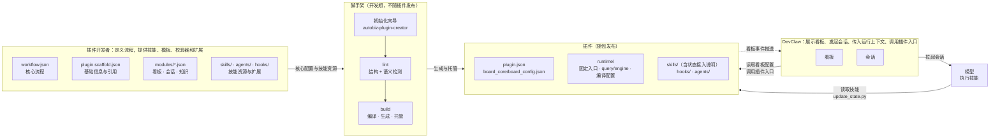

### 2. 运行期调用关系

DevClaw 只调用 `runtime/` 下的固定入口；入口通过 import 使用内部库 `query.py`（只读）和 `engine.py`（初始化与状态变更）；模型通过 `update_state.py` 提交状态变更；三个写入口提交后把看板事件推送给 DevClaw（虚线，见图 11）。会话入口内部如何组装知识和调用自定义入口见图 8。见 [interfaces.md §4](interfaces.md)。

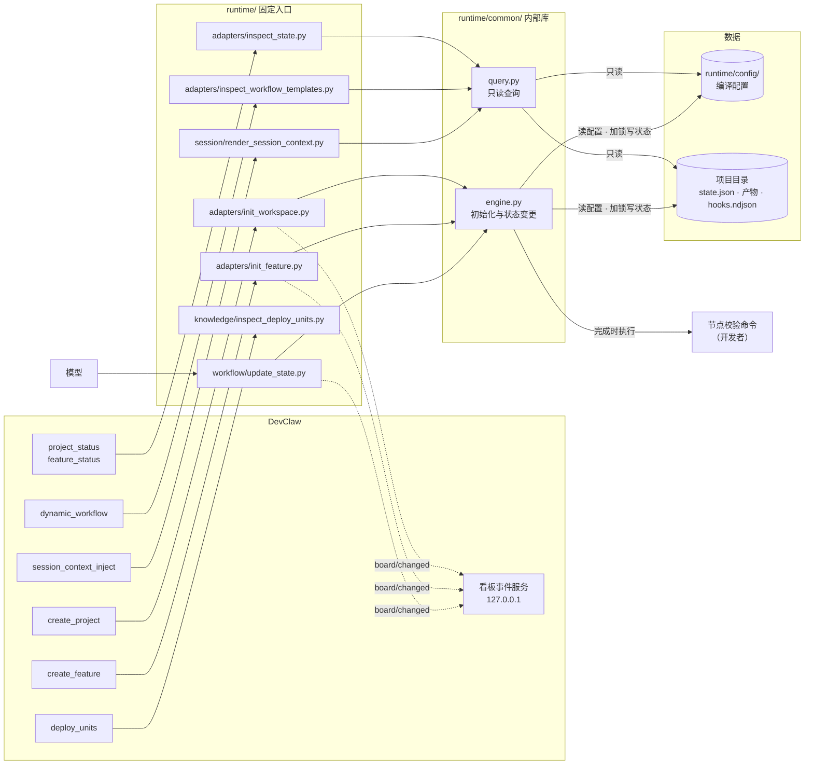

### 3. 核心配置与编译配置

人和 agent 只维护左边的核心配置；右边的编译配置只由 build 写入，插件运行时只读它们。build-manifest 记录各核心配置的摘要，lint 发现核心配置改了却没重新 build 时报 `BUILD_STALE`（见图 5）。见 [input-config.md §1.2、§6](input-config.md)、[output-spec.md §5](output-spec.md)。

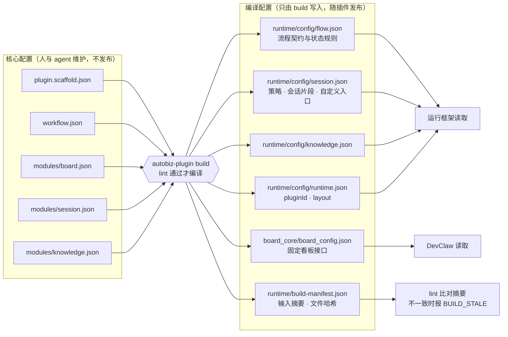

| 编译配置 | 主要来自 |
|---|---|
| `flow.json` | `workflow.json`，加上 `board.display` 中的产物显示名 |
| `session.json` | `modules/session.json`，加上知识模块注册的会话片段 |
| `knowledge.json` | `modules/knowledge.json` |
| `runtime.json` | `plugin.scaffold.json` 的 `plugin.id`、`runtime` |
| `board_config.json` | `workflow.json` + `modules/board.json` + `modules/session.json` 的节点策略 + 知识模块的命令 |

---

## 二、核心机制图

### 4. 构建流水线

前三步单独执行就是 `lint`；任何一步出现 error 都不写文件。见 [README §5](README.md)。

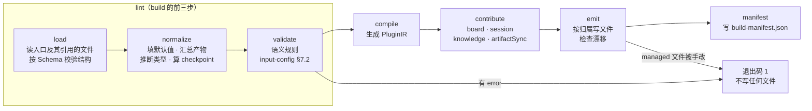

### 5. 自动检测

核心配置会被多人和 agent 修改，所以每个可能引入错误的环节都自动检测。本地钩子可以被 `--no-verify` 跳过，CI 是最后一道。见 [input-config.md §7.1](input-config.md)。

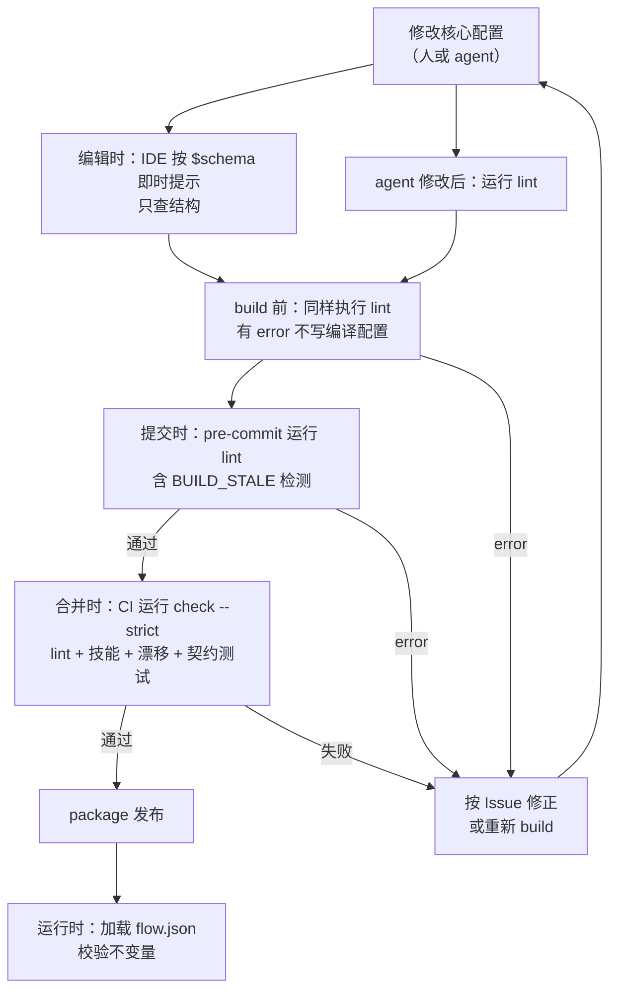

### 6. 状态推进与完成判定

模型调用 `update_state.py` 推进到 `_done` 时，框架先检查必需产物是否存在（空文件也算存在），再执行节点的单行校验命令，退出码为 0 才写入状态。见 [output-spec.md §4.4](output-spec.md)、[interfaces.md §4.2–§4.4](interfaces.md)。

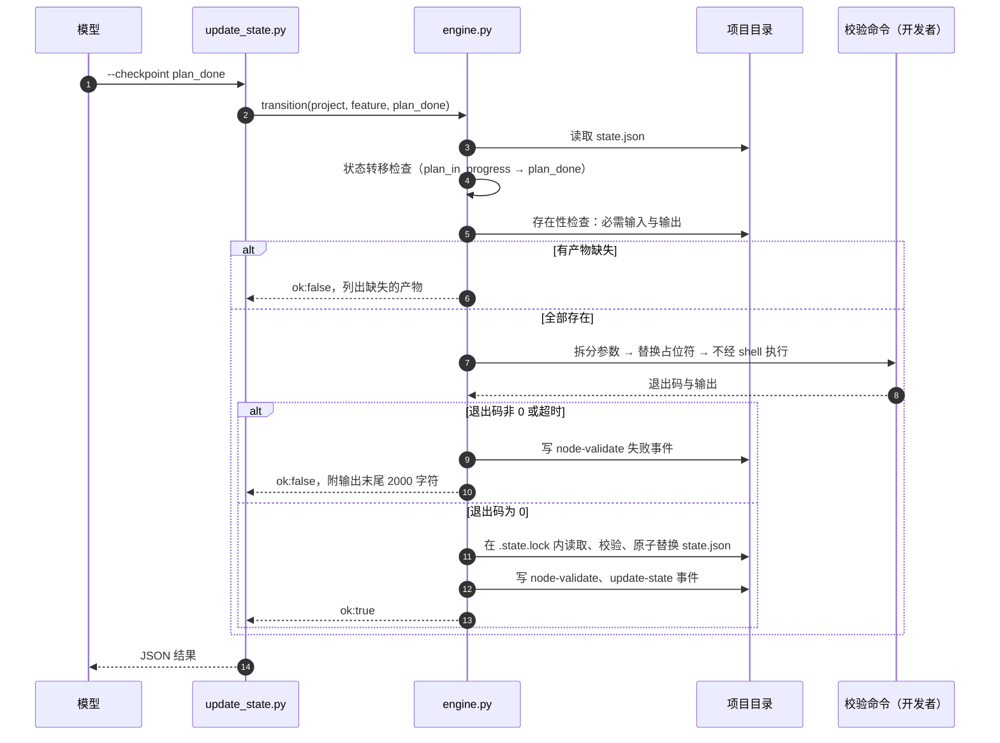

### 7. checkpoint 状态机

以最小示例为例：每个节点有 `<前缀>_in_progress`、`<前缀>_done` 两个 checkpoint，前缀取节点 id 的最后一段，按节点顺序线性推进。重开只能回到当前或之前节点的 `_in_progress`，不执行校验命令。见 [input-config.md §2.2](input-config.md)、[interfaces.md §4.2](interfaces.md)。

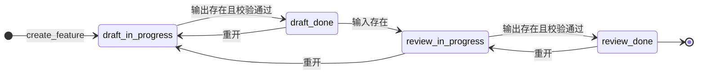

### 8. 会话内容组成

默认会话入口始终生成流程上下文和 `agentConfig`；知识段和自定义会话入口的输出按配置追加，自定义入口不能替换默认入口。见 [README §6.2](README.md)、[interfaces.md §3.3.7、§4.5](interfaces.md)。

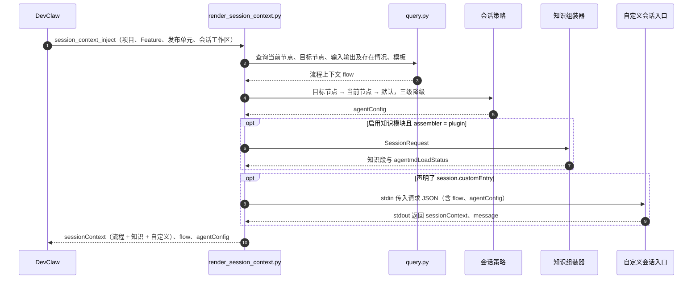

### 9. 知识模块

清单解析由 `inspect_deploy_units.py` 统一完成；组装方选择 `plugin` 时由插件组装知识段，选择 `devclaw` 时由 DevClaw 调用 `deploy_units` 后自行组装。知识仓库同步是可选项。见 [input-config.md §4.3](input-config.md)、[output-spec.md §7.1](output-spec.md)。

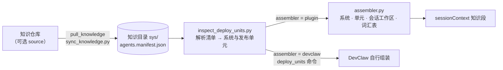

### 10. 多插件隔离

每个插件只读写自己的元数据目录，状态、锁和产物互不干扰；legacy 布局只为迁移已有插件保留，一个项目最多一个。见 [README §6.5](README.md)。

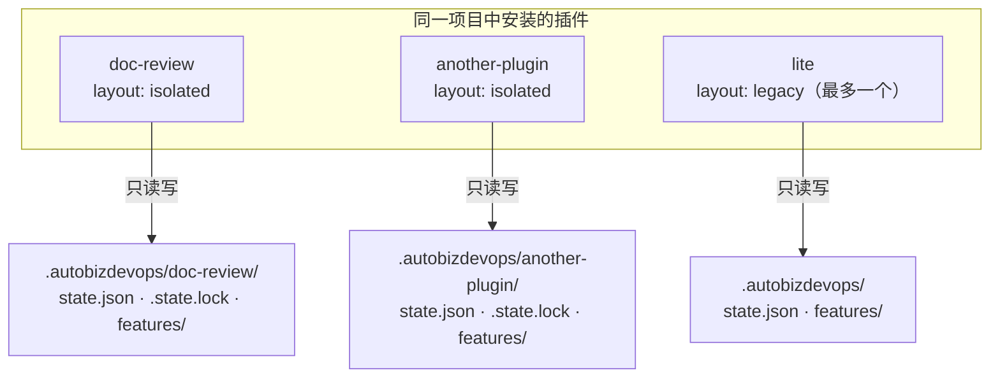

### 11. 看板事件推送

DevClaw 启动本机服务并通过环境变量告诉插件；写入口在 engine 提交、释放锁之后推送看板数据，DevClaw 按 `seq` 缓存并展示。推送失败不影响命令结果，漏收由拉取兜底。见 [interfaces.md §3.5](interfaces.md)。

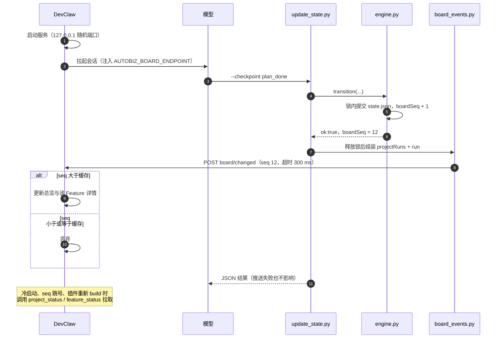
