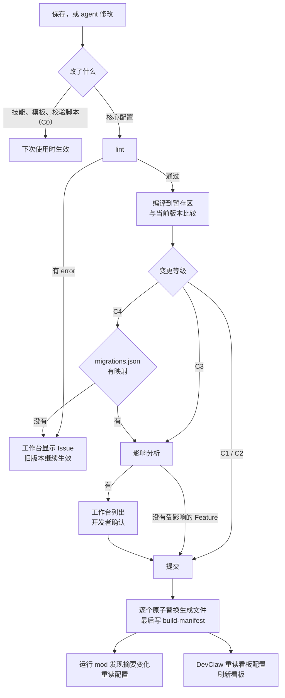

# mods 机制下的插件初始化与热更新（草案）

DevClaw 底层是类 Claude Code 的工具，提供 mods 机制：插件可以带一个钩子模块，拦截工具调用、注册工具和命令、修改系统提示、绘制面板，改了之后热重载。本文讨论有了这个机制后，脚手架的两部分工作怎么做：

1. **初始化新插件**（§3）；
2. **已有插件的热更新与变化**（§4）。

本文是草案，依赖 DevClaw 的 mods 接口，需要确认的事项见 §6。

## 0. 前提与结论

本文假设 DevClaw 的 mods 与 Claude Code 的能力相当，用到以下能力：

| 能力 | 用途 |
|---|---|
| 拦截工具调用：执行前拒绝或改写，执行后读取结果并附加给模型的上下文 | 自动检测、守卫生成文件和状态文件 |
| 注册模型可以调用的工具，并决定是否自动放行 | 脚手架命令（lint、build 等） |
| 读取会话的环境变量 | 确定会话所属的 Feature（`FEATURE_ID` 等）和所选发布单元 |
| 会话开始时执行 | 检查知识仓库是否过期并后台同步（R9） |
| 技能展开时改写技能内容 | 按当前流程注入产物约定（R2） |
| 轮次结束时拦下结束（Stop） | 可用于更严格的完成判定；本设计不用，状态推进不在 mod 中（§2.3） |
| 注册斜杠命令 | `/autobiz new`、`/autobiz open` |
| 面板（含 Input、Select 表单）、确认对话框、状态栏、提示消息 | 插件工作台、建模确认、更新通知 |
| 子代理 | 真实试跑 |
| 读写文件、运行本机命令 | 调用 Python CLI 和运行框架入口 |
| 会话内存储、跨会话存储 | 工作台状态 |
| 插件目录热重载 | 开发态即改即生效 |

结论：

- **mod 不替代核心配置和编译**。插件内容仍然是“核心配置 → lint → 编译配置”，运行期只读编译配置（D19）。mod 改变的是谁来触发、什么时候生效、怎么约束；
- **分两个 mod**。开发 mod 在脚手架这边，包含原来的 `autobiz-plugin-creator` 技能，负责初始化和开发态的热更新；运行 mod 随每个插件发布，是同一份通用代码，负责守卫和产物约定注入；状态推进不在 mod 中，由 build 写进技能 `SKILL.md` 开头的状态维护片段完成（§2.3）；
- **热更新的难点是在途 Feature 的状态兼容，不是重载本身**。按变更等级处理：不影响状态的修改即改即生效；影响状态的修改先做影响分析；破坏性修改必须带迁移映射。

## 1. 设计原则

| # | 原则 | 原因 |
|---|---|---|
| 1 | 插件内容是数据，mod 是通用解释器。所有插件的运行 mod 代码相同（managed，跟随 `coreVersion`），插件之间只有编译配置不同 | 日常修改只是数据变化，不需要改代码或重载代码；运行 mod 可以统一测试 |
| 2 | 保留编译，改由 mod 自动触发 | 判断状态是否兼容，要比较前后两版编译结果；金样测试不用变 |
| 3 | `state.json` 仍然只由 `engine.py` 写入 | 不维护 TS、Python 两套状态逻辑；锁、原子替换、校验命令都留在 engine 中 |
| 4 | 开发态放开，发布态设门槛 | 开发者在本机改完马上能看到效果；装到别人那里的插件，破坏性修改必须带迁移 |

## 2. 两个 mod

| | 开发 mod `autobiz-plugin-creator` | 运行 mod |
|---|---|---|
| 位置 | 脚手架仓库；作为 DevClaw 插件装在开发者的环境中 | 每个生成插件的 `runtime/mod/`，随插件发布 |
| 组成 | 原 creator 技能（对话流程、建模指南）+ mod 钩子 | 通用 mod 代码 + build 生成的入口 |
| 归属 | 不随插件发布 | `managed`，入口为 `generated` |
| 负责 | 自动检测、文件归属守卫、脚手架命令工具、建模确认、开发挂载与自动 build、工作台 | 状态文件守卫、技能展开时注入产物约定、感知配置变化、人工状态操作、看板刷新 |
| 调用 | `autobiz-plugin` CLI（Python） | `runtime/` 下的 Python 入口 |

技能还要保留。怎么和开发者对话、怎么把业务拆成节点，需要模型判断，写在技能里；检测、守卫、确认、生成这些确定的事交给 mod。

下面逐项列出每个 mod 具体做什么、能做到什么程度、有多必要。必要性分三档：

- **P0 必要**：把现在只写在技能里的规则变成宿主强制执行，或者是热更新本身离不开的机制。不做就有正确性风险，或者热更新不成立；
- **P1 值得做**：明显减少出错和等待，但现有做法也能用；
- **P2 体验**：锦上添花，放到最后。

### 2.1 开发 mod

| # | 能力 | 怎么做 | 能做到什么程度 | 必要性 | 不做时 |
|---|---|---|---|---|---|
| A1 | 修改后自动检测 | 在 Edit、Write 上挂执行后钩子：路径落在 `plugin.scaffold.json`、`workflow.json`、`modules/*.json`、`migrations.json` 上时运行 `lint --json`，把 Issue 放进工具结果的附加上下文，模型在同一轮就能读到 | agent 用 Edit、Write 改的，全部覆盖，不靠模型自觉。用 Bash 改的（`sed -i`、重定向），只能从命令文本中识别路径，尽力而为。开发者在编辑器里手改的，mod 收不到文件变化事件，改为每 2 秒比对摘要，结果显示在工作台，下一轮再交给模型 | **P0**：D20 要求“agent 修改后检测”，现在只是技能里的一句话 | 到提交前或 build 前才发现 |
| A2 | 文件归属守卫 | 执行前钩子：目标路径按 `build-manifest.json` 中记录的归属判断，generated、managed、module 文件直接拒绝（内置知识组装脚本除外，插件可以替换它），拒绝理由告诉模型应该改哪个核心配置 | Edit、Write 全部拦住，Bash 尽力而为。在写入之前拦，模型不会白改一轮 | **P0**：为了让检查通过去改生成文件，是模型的常见行为，技能里专门禁止；实现成本很低 | 事后由 `check` 报 `DRIFT_*`，再回滚 |
| A3 | 脚手架命令注册为工具 | 注册 `autobiz_lint`、`autobiz_build`、`autobiz_check`、`autobiz_simulate`、`autobiz_package`、`autobiz_diff`、`autobiz_skills`。mod 一次性确定解释器（`python3`、`python` 或 `py -3`）和脚本路径，用参数数组调用，返回 CLI 的 JSON。这些工具只读写插件目录，自动放行，不弹权限确认 | 模型不再拼命令行，`${pluginPath}` 没替换、Windows 引号、`python` 与 `python3` 混用这些问题都消失 | P1 | 继续用 Bash 调 CLI，能用但容易出错 |
| A4 | 建模确认 | 模型调用 `autobiz_propose_nodes` 提交结构化的节点表，参数按 workflow 节点的 Schema 校验。mod 算出与当前流程的差异和变更等级（§4.3），弹出确认；确认后由 mod 写 `workflow.json` 并检测 | 新建时开发者确认整张表；修改时确认的是差异，例如“删除节点 review，等级 C4，影响 3 个在途 Feature”。JSON 由 mod 写，模型不手写 | P1：流程属于业务决策，现在靠模型自觉询问；修改时给出变更等级和影响尤其有用 | 模型在对话中询问，开发者回答“可以” |
| A5 | 开发挂载与自动 build | lint 通过后按变更等级自动 build（§4.4）；第一次 build 成功后，调用 DevClaw 接口把源目录挂成开发插件 | 保存后几秒内看板就是新的，不用打包、导入 | **P0**（对“随时改”这个目标）：现在的修改循环里最慢的就是打包和重新导入。但这项能力主要在 DevClaw，mod 只负责调用 | 每次修改后打包、导入 |
| A6 | 斜杠命令 | `/autobiz new`、`/autobiz open <目录>`、`/autobiz status`、`/autobiz build`；不需要模型参与的由 mod 直接回答 | `status`、`build` 立即返回，不占用模型轮次 | P1 | 让模型去执行 |
| A7 | 工作台面板 | 显示插件信息、节点表、checkpoint 链、产物流向图（桌面端用 Svg 绘制）、当前 Issue、编译是否过期、变更等级、挂载状态。基础信息用表单（Input、Select）填写，插件 ID 在输入时实时规范化 | 桌面端和终端都能绘制；移动端没有输入框，只能查看 | P2：这些信息 `lint --preview` 都能给出，面板的作用是让变化一眼可见 | 看文本输出 |
| A8 | 真实试跑 | 在沙盒项目中建 Feature，用子代理逐节点执行技能 | 端到端跑出真实产物和状态推进，会消耗真实的模型用量 | P2 | `simulate` 用桩产物模拟 |

开发 mod 还可以在 creator 技能展开时附上当前插件的状态（流程摘要、最近一次检测结果），模型不用先去读文件。

### 2.2 运行 mod

| # | 能力 | 怎么做 | 能做到什么程度 | 必要性 | 不做时 |
|---|---|---|---|---|---|
| R1 | 状态文件守卫 | 执行前钩子：拒绝 Edit、Write 写入 `{metaDir}/` 下的 `state.json`、`.state.lock`、`hooks.ndjson`；Bash 命令中出现这些路径的写操作也拒绝 | Edit、Write 全部拦住，Bash 尽力而为 | **P0**：校验命令只在 engine 推进时执行，模型直接改 `state.json` 就能绕过节点完成判定（D13、D14）。校验反复不通过时，模型确实可能这样做 | 没有防护，只能事后从 `hooks.ndjson` 与 `state.json` 对不上发现 |
| R2 | 技能展开时注入产物约定 | 节点技能被调用时，运行 mod 按当前的 `flow.json` 和 Feature 状态，在技能正文后附上：本节点要读的输入、要写的输出（相对 `FEATURE_DIR` 的路径）及当前是否存在。不含任何状态操作（状态由 SKILL.md 开头的状态维护片段推进，§2.3） | 产物约定始终与当前流程一致，不需要写进 SKILL.md | **P0**：完成时框架检查“输出写在约定路径上”，路径必须准确送到模型面前；这也是热更新能到达模型的途径 | 只靠会话开始时注入的流程上下文 |
| R3 | 感知配置变化 | 每次自动推进、展开技能之前，比对 `build-manifest.json` 中的摘要；变了就重读编译配置，并提示一次“流程已更新” | 数据热更新就是在这里生效的（§4.2） | **P0**（对热更新） | 改了流程要重开会话 |
| R4 | 自动推进状态 | 不做：状态由 build 写进 `SKILL.md` 开头的状态维护片段推进，不依赖 mods（§2.3） | — | — | — |
| R5 | 人工状态操作 | `/autobiz state` 命令：查看当前状态，重开到某个节点（必须写原因）；内部调用 `update_state.py` | 模型不再持有任何状态工具，例外情况由人处理 | P1 | 只能在看板上操作（如果看板提供） |
| R6 | 看板刷新与产物实时刷新 | 推进成功后通知 DevClaw 刷新看板；会话中的 Write 落在 `FEATURE_DIR` 下时，防抖后通知刷新产物状态 | 可以替代 D21 的本机服务，还顺带实现了 D21 推迟的“产物实时刷新”：那项功能本来就需要知道模型写了哪些文件，运行 mod 正好能看到 | P1，前提是 DevClaw 给 mod 提供看板接口；没有就按 D21 做 | 按 D21 实现本机服务 |
| R7 | 下一步建议 | 节点完成后，把下一个节点的技能（如 `/doc-review`）放进输入框的建议里，按 Tab 采用 | — | P2 | 在看板上点下一个节点 |
| R8 | 开发者扩展 | `entry.ts` 静态导入 `hooks/extension.ts`，开发者可以加自己的面板、命令、守卫 | 给开发者的自由度出口，不用改托管代码 | P2，按需开放：扩展是插件里的任意代码，要和 DevClaw 的权限、审核策略一起定 | 只能用命令钩子 |
| R9 | 知识按需加载 | 会话开始只注入知识索引；模型第一次触达某个发布单元的代码时，附上该单元的知识；节点技能展开时附上节点声明的知识；会话开始时检查知识仓库是否过期，后台同步；引导知识沉淀。组装逻辑仍在 `runtime/knowledge/` 的 Python 中，规则见 §2.4 | 知识占用的上下文从“选了几个单元就全部加载”降到“用到哪个加载哪个”；不用再手动 `pull_knowledge` | P1：现有一次性注入能用，但发布单元多、知识大时挤占上下文，且大部分用不到 | 继续由 `session_collector_context_inject` 一次性注入四层知识 |

刻意不放进运行 mod 的：

- **用修改系统提示来注入流程上下文**：每次状态变化都改系统提示，会让整个提示缓存失效，成本高。会话开始时仍由 `session_collector_context_inject` 注入，之后的变化通过技能展开（R2）和 `update_state.py` 的返回结果送达；
- **由 mod 提供看板读取**：没有会话时看板也要显示，而 mod 是随会话加载的（待确认，§6）。

### 2.3 状态推进：不放在 mod 中

状态推进不由运行 mod 负责，也不用宿主钩子：build 把状态维护片段写进每个节点技能 `SKILL.md` 的开头，模型在技能开始和完成时执行其中的 `update_state.py` 命令，规则见 [output-spec.md §6.1](output-spec.md)。所有节点（包括编码节点）用同一套规则，推进到 `_done` 时 engine 检查必需产物都存在且非空。

本草案原先设计的更细的完成判定，脚手架都不提供；需要时写在技能正文中，作为执行完成命令的前提：

- 校验不通过时拦下结束、自动重试（`runtime.autoRetry`）；
- 人工关口 `humanGate`；
- 完成时机 `completeOn`（交接时、会话结束时判断完成）；
- 完成后又改了本节点产物时重新校验，修改上游产物时询问是否退回；
- 代码提交作为产物、等子代理全部结束再判断、按提交缓存校验结果（原 §2.8，已删除）。

运行 mod 在此之上只做展示：推进后刷新看板（R6），把下一个节点的技能放进输入建议（R7）。

### 2.4 知识按需加载（R9）

现在的问题：启用知识模块且 `assembler = plugin` 时，`session_collector_context_inject` 在会话开始时把系统级、单元级、会话工作区、领域词汇表四层知识一次性并入 `sessionContext`（[output-spec.md §7.1](output-spec.md)）。选了多个发布单元时，大部分单元级知识在这个会话里用不到，却一直占着上下文；知识仓库要靠 `pull_knowledge` 手动同步；知识沉淀要人想起来去看板上发起。

目标：知识在用到时才进入会话，同步和沉淀不依赖人记得操作。清单解析和组装逻辑不变，仍由知识组装脚本完成（默认为内置的 `render_collected_session_context.py`），只保留一份实现；运行 mod 只决定**什么时候、加载哪一部分**。

**加载方式**：`modules/knowledge.json` 新增 `assembly.loading`：

| 取值 | 行为 | 适用 |
|---|---|---|
| `eager` | 现有行为：会话开始时注入全部四层 | 不支持 mods 的宿主；知识很小的插件 |
| `lazy`（启用运行 mod 时默认） | 会话开始只注入索引，其余按下表触发 | 默认 |

**`lazy` 下的触发点**：

| 时机 | 触发事件 | 加载内容 | 说明 |
|---|---|---|---|
| 会话开始 | `session_collector_context_inject`（仍由 DevClaw 调用） | 系统级知识、领域词汇表、会话工作区层，加上所选发布单元的索引（每个单元一行：ID、名称、描述、`localRepoPath`） | 只在会话开始注入一次，不改系统提示，不影响提示缓存（见 §2.2“刻意不放进运行 mod 的”） |
| 触达发布单元 | Read、Grep、Glob、Edit、Write 的执行后钩子：路径落在某个所选单元的 `localRepoPath` 下 | 该单元的单元级知识，附在这次工具结果的附加上下文里 | 每个单元每个会话只附一次，记录在会话内存储中。类似 Claude Code 进入子目录时加载该目录的 CLAUDE.md。Bash 命令只能按文本识别路径，尽力而为 |
| 模型主动查询 | 注册只读工具 `knowledge_lookup(unit, topic?)`，自动放行 | 指定单元的知识；带 `topic` 时只返回匹配的段落 | 覆盖钩子识别不到的情况，例如模型还没读代码就要先了解某个单元 |
| 节点技能展开 | 与 R2 同一个钩子 | 节点声明的知识：`knowledge.nodes.<节点 id>.include`，知识目录下的相对路径，可用 `${deployUnitId}` 对所选单元逐个展开 | 例如需求分析节点固定带上业务规则文档。未声明时不附加 |

`knowledge_lookup` 和钩子都调用新增的 `runtime/knowledge/lookup.py`，它复用组装器的分层读取，只按单元或主题取一部分。`session_collector_context_inject` 在 `lazy` 下调用组装器的索引模式，`agentmdLoadStatus` 中未加载的单元标为 `"deferred": true`，DevClaw 照常显示。

**同步**（声明了 `knowledge.source` 时）：

- 会话开始时，运行 mod 比对知识目录记录的 ref 与远端；过期时在后台运行 `sync_knowledge.py`，完成后弹提示，新知识从下一个会话起生效（本会话已经注入的索引不变，按需加载的部分读到的是新内容）；
- 比对和同步都有超时，失败只提示，不阻塞会话；同一个插件同时只跑一个同步，沿用 `.knowledge.lock`；
- `pull_knowledge` 宿主命令保留：会话以外（例如看板刷新支持的发布单元）仍要用它。

**知识沉淀**：

- 节点完成（推进到 `_done`）且该节点在 `knowledge.nodes.<节点 id>.sediment` 中声明为 `true`，或 Feature 走完最后一个节点时，把看板配置中的沉淀技能（`knowledge_config.nextAction.slashSkill`，默认 `knowledge-sync`）放进输入框建议，与 R7 同一机制；
- 守卫：声明了 `knowledge.source` 时，知识目录是同步缓存，下次同步会覆盖。Edit、Write 写入该目录一律拒绝，拒绝理由告诉模型改走知识沉淀流程。未声明 `source` 时，知识目录是开发者资源，不加守卫（开发态由 A2 按归属处理）。

**不搬进 mod 的**：

- 看板上支持的发布单元列表：建 Feature 时还没有会话，mod 不在（§2.5），继续由 build 和 `pull_knowledge` 预先生成；
- `assembler = devclaw`：知识段由 DevClaw 组装，运行 mod 只提供 `knowledge_lookup` 和沉淀引导，不改会话开始的注入；
- 组装逻辑本身：不用 TS 重写，理由同 §1 原则 3。

**依赖**：运行 mod 要知道本会话选了哪些发布单元。现在 `create_feature` 不保存发布单元，每次会话由宿主作为参数传给 `session_collector_context_inject`（[interfaces.md §3.3.7](interfaces.md)），mod 拿不到。需要 DevClaw 提供（§6 第 11 项）。

### 2.5 做不到或只能尽力而为的

| 限制 | 影响 | 对策 |
|---|---|---|
| Bash 命令只能按文本识别路径 | A1、A2、R1 拦不全 `sed -i`、重定向、脚本内部的写文件 | 守卫以 Edit、Write 为主；可选：engine 发现 `state.json` 与 `hooks.ndjson` 中最后一次推进对不上时报警 |
| mod 收不到文件变化事件 | 开发者在编辑器里手改，不能立刻检测 | 每 2 秒比对核心配置的摘要 |
| mod 随会话加载 | 没有会话时 mod 不工作 | 看板读取保留 inspectCommands；会话以外的写入口（`create_project`、`create_feature`）由 DevClaw 直接调用 |
| 判断不了产物内容 | 业务产物是否合格，mod 管不了 | 仍由节点校验命令负责 |
| 状态推进取决于模型 | 模型没有执行状态维护片段中的命令时，看板停在旧状态 | 片段固定放在 `SKILL.md` 开头；漏推进时由用户用 R5 补上 |
| 移动端没有输入框 | 工作台表单在移动端不可用 | 移动端只读 |
| 接口还在变化 | Claude Code 的 mods 接口标注为 early access，DevClaw 的版本节奏未知 | 运行 mod 声明所需的宿主接口版本；`check` 的契约测试覆盖运行 mod |
| 会话压缩后知识丢失 | R9 按需附上的单元知识随压缩被摘要掉，而“每单元只附一次”的记录还在，再次触达时不会重新附上 | mod 能收到压缩事件时清空记录；收不到时靠 `knowledge_lookup` 让模型自己重新查 |

### 2.6 分期建议

| 期 | 开发 mod | 运行 mod | 依赖 DevClaw 的 |
|---|---|---|---|
| 一 | A1 自动检测、A2 文件归属守卫、A3 命令工具、A6 斜杠命令 | R1 状态文件守卫、R2 产物约定注入、R3 感知配置变化、R5 人工状态操作 | 只需要通用的 mods 能力 |
| 二 | A4 建模确认、A5 开发挂载与自动 build | R6 看板刷新、R9 知识按需加载 | 源目录挂载、给 mod 的看板接口；A4 还依赖 CLI 的 `diff`；R9 依赖 mod 能拿到所选发布单元 |
| 三 | A7 工作台面板、A8 真实试跑 | R7 下一步建议、R8 开发者扩展 | 子代理、扩展代码的权限策略 |

第一期做完，产物约定由技能展开时注入，SKILL.md 中由 build 维护的只剩状态维护片段；第二期做完，开发态的“改完就生效”才真正成立。

### 2.7 插件目录的变化

在 [output-spec.md §1](output-spec.md) 的基础上增加：

```text
<plugin>/
├── plugin.json                     # generated  新增 "hooks": "./runtime/mod/hooks.json"
├── migrations.json                 # developer  状态迁移映射，需要时才有（§4.5，不随包发布）
├── hooks/extension.ts              # developer  可选：开发者自己的 mod 钩子（plugin.modExtension 声明）
└── runtime/
    ├── mod/
    │   ├── hooks.json              # generated  {"modules": ["./entry.ts"]}
    │   ├── entry.ts                # generated  静态导入运行 mod 和开发者扩展
    │   └── runtime.ts              # managed    通用运行 mod
    └── config/
        └── migrations.json         # generated  编译后的迁移表，随包发布
```

一个插件只能有一个钩子模块，模块中也不能动态导入，所以由生成的 `entry.ts` 静态导入运行 mod 和开发者扩展。开发者扩展不能注册与运行 mod 同名的工具，也不能拦截运行 mod 用来自动推进的事件（build 报 `MOD_EXTENSION_CONFLICT`）。

运行 mod 每个插件带一份，而不是做成所有插件共用的一个 DevClaw 插件。这样各插件可以停在不同的框架版本上，与现在 `runtime/` 的做法一致。同一个会话加载了多个插件的运行 mod 时，工具名带插件前缀，各自的守卫只管自己的 `{metaDir}`。

## 3. 第一部分：初始化新插件

### 3.1 用到的能力

新建插件主要用开发 mod 的 A1～A7（§2.1）。从使用者的角度看，与现在的 creator 技能（[interfaces.md §1.6](interfaces.md)）相比：

| 环节 | 现在 | mods 下 |
|---|---|---|
| 发起 | 触发 `/autobiz-plugin-creator` 技能 | `/autobiz new` 打开工作台，模型按技能开始对话 |
| 基础信息 | 模型逐项问答 | 工作台表单，插件 ID 实时规范化 |
| 调用脚本 | 模型拼 `python3 "${pluginPath}/…"` | 调用注册好的工具（A3） |
| 写 `workflow.json` | 模型确认后手写 JSON | 模型提交节点表，开发者确认后由 mod 写入（A4） |
| 检测 | 技能规定每次修改后运行 | 修改后自动执行（A1） |
| 试跑 | 打包、导入 DevClaw，或 `simulate` | 挂载为开发插件直接试（A5）；`simulate` 保留，供手动验证 |

### 3.2 流程

| 步骤 | 开发者 | 开发 mod / 模型 | 产出 |
|---|---|---|---|
| 1. 发起 | `/autobiz new` | 打开工作台 | — |
| 2. 基础信息 | 填表单 | 记下目录、插件 ID 和插件名，还不调用 CLI（`new` 要有节点才能通过 lint，D56） | — |
| 3. 盘点技能 | 指定技能来源 | 列出技能，工作台显示技能卡片，记下要导入的目录 | — |
| 4. 建模 | 用自己的话描述流程 | 模型整理节点表，提交到工作台 | 待确认的节点表 |
| 5. 确认 | 点“确认写入”，或要求修改 | 新建时 mod 把基础信息、节点表和要导入的技能作为 `--answers` 调用 `new --yes`；修改时按表写入 `workflow.json`，自动 lint | `plugin.scaffold.json`、`workflow.json`、`skills/<技能>/` |
| 6. 模块 | 回答看板、会话、知识的问题（表单加对话） | 写需要的模块文件，自动 lint | `modules/*.json` |
| 7. 生成并挂载 | — | lint 没有 error 后自动 build，挂载为开发插件 | 看板上出现新插件 |
| 8. 试跑 | 在沙盒项目中建 Feature，逐节点运行 | 工作台显示状态推进和校验结果 | — |
| 9. 发布 | 确认版本 | 调用 `package` | zip |

和现有的 creator 技能（[interfaces.md §1.6](interfaces.md)）相比，步骤不变，变化有四点：

- 结构化字段用表单填写，确认用按钮；
- `workflow.json` 由 mod 按确认后的表写入，模型不手写 JSON；
- 检测和生成自动触发；
- 试跑直接在 DevClaw 中进行，不用打包导入。

修改已有插件也从工作台进入（`/autobiz open <目录>`），之后的流程见第二部分。

## 4. 第二部分：已有插件的热更新与变化

### 4.1 两种场景

| 场景 | 插件从哪里加载 | 谁来改 | 怎么生效 |
|---|---|---|---|
| 开发态 | 开发者本机，DevClaw 挂载源目录 | 开发者手改或让 agent 改 | 保存后自动检测、编译、生效（§4.4） |
| 发布态 | 其他人的 DevClaw，安装的是发布包 | 开发者发布新版本 | 更新插件后生效，在途 Feature 按迁移表迁移（§4.7） |

两种场景用同一套变更等级（§4.3）。

### 4.2 数据热更新与代码热更新

| | 数据热更新 | 代码热更新 |
|---|---|---|
| 改了什么 | 编译配置、技能、模板、校验脚本 | 运行 mod（框架升级）、开发者扩展 `hooks/extension.ts` |
| 频率 | 每次日常修改 | 很少 |
| 怎么生效 | 运行 mod 每次使用配置前比对 `build-manifest.json` 中的摘要，有变化就重读编译配置，mod 本身不重载 | DevClaw 的插件目录热重载：重新执行 `register`，会话存储保留，模块内的变量重置 |

数据热更新不依赖 mod 重载。Claude Code 只在钩子模块自己的源文件变化时重载，配置文件变化不会触发；DevClaw 的行为待确认，所以这里不依赖它。

### 4.3 变更等级

build 编译出新流程后，与当前的 `runtime/config/flow.json` 比较，得出变更等级（`autobiz-plugin diff` 单独输出这个结果）。等级决定开发态能否自动生效，以及发布态要升哪一位版本号。

| 等级 | 典型修改 | 对在途 Feature 的影响 | 开发态 | 发布态 |
|---|---|---|---|---|
| C0 资源 | 技能正文（托管片段以外）、模板内容、校验脚本内容、`references/`、`agents/*.md` 内容 | 无 | 不需要 build，下次调用或下次会话生效 | patch |
| C1 展示 | 节点显示名和描述、`nextAction` 文案、阶段名 | 无 | 自动 build，看板重读 | patch |
| C2 策略 | `session.policies`、子代理、知识配置、看板可选能力的开关 | 只影响新会话 | 自动 build，新会话生效 | minor |
| C3 流程扩展 | 追加或插入节点，给节点加输入或输出，改校验命令、产物路径 | checkpoint 仍然有效，但可能有 Feature 推进不了 | build 后做影响分析（§4.5）：没有受影响的 Feature 就自动生效；有就在工作台列出，开发者确认后生效 | minor |
| C4 流程破坏 | 删除节点，改节点 id（checkpoint 名随之变化），调整节点顺序（改了 `seq` 的先后） | checkpoint 不存在或含义改变，按现有规则 `state.json` 会拒绝写入（[output-spec.md §4.2](output-spec.md)） | 必须在 `migrations.json` 中写迁移映射，否则不生效（`FLOW_BREAKING`） | major，必须带迁移 |
| C5 身份 | `plugin.id`、`runtime.metaRoot` | 状态找不到 | 禁止（`PLUGIN_ID_CHANGED`、`LAYOUT_CHANGED`） | 禁止 |
| 框架升级 | `coreVersion`、模块版本 | 可能涉及 `state.json.schemaVersion` | 更新脚手架后执行 doctor 替换运行框架（D57），之后代码热更新 | 跟随框架版本 |

C3 与 C4 的判定规则：旧 checkpoint 链是新链的子序列（顺序不变，只增不减）就是 C3，否则是 C4。

### 4.4 开发态的更新流水线



规则：

- 检测没通过或者等级不允许时，旧版本继续生效，不会出现一半新一半旧；
- 编译先写暂存区，提交时逐个原子替换，`build-manifest.json` 最后写。运行 mod 和 DevClaw 以 manifest 为准：manifest 中的摘要与文件对不上时（提交到一半），继续用旧配置；
- engine 一次推进只读 `flow.json` 一个文件，所以单次推进看到的一定是同一版流程；
- 手动修改：开发 mod 拦截不到编辑器保存，改为每 2 秒比对一次核心配置的摘要，或者使用 DevClaw 提供的文件变化事件（如果有）；
- 工作台可以关闭自动 build，关闭后只提示 `BUILD_STALE`。

### 4.5 在途 Feature：flowRev 与迁移

`state.json` 中每个 Feature 增加 `flowRev` 字段，记录它创建时或最近一次推进时的流程版本（checkpoint 链的摘要）。只有 C3、C4 会改变 flowRev。

迁移映射写在开发者的 `migrations.json` 中，由入口文件引用，build 编译到 `runtime/config/migrations.json` 并随包发布：

```json
{
  "$schema": "./.scaffold/migrations.schema.json",
  "steps": [
    {
      "from": "rev:3f2a9c1e",
      "renameNodes": { "plan": "design" },
      "removeNodes": { "review": "design_done" },
      "remapCheckpoints": { "test_done": "deploy_in_progress" }
    }
  ]
}
```

| 字段 | 含义 |
|---|---|
| `from` | 这一步适用的旧版本。build 报 `FLOW_BREAKING` 时会给出当前的 rev，照抄即可；这一步的目标版本由 build 记录 |
| `renameNodes` | 旧节点 id → 新节点 id，两个 checkpoint 按 `_in_progress`、`_done` 一一对应 |
| `removeNodes` | 被删除的节点 → 停在这个节点上的 Feature 移到哪个 checkpoint |
| `remapCheckpoints` | 其余情况（例如调整顺序）逐个映射 |

迁移怎么执行：

- **读取**（看板查询、会话上下文）：`query.py` 在内存中按迁移表换算后展示，不写文件；
- **写入**（推进、重开）：`engine.py` 在锁内先迁移这个 Feature，再执行推进，并在 `hooks.ndjson` 中写一条 `state-migrate` 事件；
- 换算后仍然不在当前流程中的 checkpoint，对应的 Feature 标记为“流程已变化”：看板显示原因，推进被拒绝，直到开发者补上映射；
- C3 不需要映射：旧链是新链的子序列，原来的 checkpoint 都有效，只更新 `flowRev`。

**影响分析**检查的是：每个在途 Feature 按新流程走，下一次推进需要的产物是否都在。例如在某个 Feature 当前位置之前插入了新节点，而后面的节点要读新节点的产物，这个 Feature 就会推进不了。检查范围在开发态是 DevClaw 中挂载了该插件的项目（需要 DevClaw 提供项目列表，或者开发者在工作台中选），在发布态是使用者加载新版本时自己的项目。

### 4.6 会话进行中发生更新

| 情况 | 处理 |
|---|---|
| C1、C2 | 展示类变化不需要告诉模型；C2 的会话策略只影响新会话 |
| C3 | 下一次展开技能时说明已经是新的（R2）；当前节点的输入或输出变了时，提示开发者一次，并在下一次工具结果中告诉模型 |
| C4，当前 Feature 已迁移 | 自动推进按新流程判断；当前节点被删除或改名时，按迁移表落到新的 checkpoint，并提示用户一次。模型不接触 checkpoint，不受影响 |
| 代码热更新 | 运行 mod 重新执行 `register`；正在进行的推进由 engine 的锁保证完整 |

### 4.7 发布态更新

- `package` 按变更等级检查版本号：C4 必须升主版本并带迁移步骤，否则报 `MIGRATION_MISSING`；其他等级版本号升得不够时报 `VERSION_BUMP`（warning）；
- 打包时把本版本的 flowRev 记进 `runtime/config/migrations.json` 的历史，用来判断使用者的旧 Feature 来自哪个版本；
- 使用者更新插件后：框架版本有变化时代码热更新，配置按数据热更新生效，在途 Feature 按 §4.5 在下次写入时迁移；
- 回滚：C0～C2 可以直接装回旧版本；C3 回滚后，已经走到新增节点上的 Feature 在旧版本中推进不了；C4 不支持回滚，旧版本不认识迁移后的 checkpoint。

## 5. 对现有设计的影响

| 位置 | 改动 |
|---|---|
| D9、[interfaces.md §1.6](interfaces.md) | creator 从技能改为插件：技能 + 开发 mod |
| D16、[output-spec.md §1](output-spec.md) | 新增 `runtime/mod/`；`plugin.json.hooks` 指向运行 mod；开发者的 mod 钩子放在 `hooks/extension.ts`，由 `plugin.modExtension` 声明 |
| D11、D19 | 运行期只读编译配置不变 |
| D20 | “agent 修改后”这一环由开发 mod 的钩子保证（提交前检查和 CI 已由 D41 去掉） |
| D21 | 会话中的推送改为运行 mod 直接通知 DevClaw，并增加产物实时刷新（R6）；DevClaw 不给 mod 提供看板接口时才保留本机服务 |
| [output-spec.md §4.2](output-spec.md) | Feature 增加 `flowRev`；“checkpoint 不在当前配置中时拒绝写入”改为先查迁移表 |
| [output-spec.md §6.1](output-spec.md) | 状态维护片段保留；输入输出约定由技能展开时注入（R2） |
| [interfaces.md §4.2](interfaces.md) | `update_state.py` 增加迁移步骤 |
| [interfaces.md §1.1](interfaces.md) | 新增 `autobiz-plugin diff`：输出变更等级和影响分析，开发 mod 和 `package` 都使用 |
| [input-config.md §4.3](input-config.md)、[schemas/modules/knowledge.schema.json](../schemas/modules/knowledge.schema.json) | `knowledge.json` 新增 `assembly.loading`（`eager` / `lazy`）和 `nodes.<节点 id>.include`、`nodes.<节点 id>.sediment`（§2.4）；`nodes` 中的节点 id 必须存在于 `workflow.json` |
| [output-spec.md §7.1](output-spec.md) | 知识模块新增 `runtime/knowledge/lookup.py`；内置组装脚本增加索引模式；声明 `source` 时运行 mod 会话开始自动同步，`pull_knowledge` 保留给会话以外使用 |
| [interfaces.md §3.3.7](interfaces.md) | `loading = lazy` 时 `sessionContext` 的知识段只有系统级、词汇表、会话工作区和发布单元索引；`agentmdLoadStatus` 中未加载的单元带 `"deferred": true` |
| [input-config.md](input-config.md) | 新增 `migrations.json`、`plugin.modExtension`；新增检查规则 `FLOW_BREAKING`、`MIGRATION_MISSING`、`CHANGE_IMPACT`、`VERSION_BUMP`、`MOD_EXTENSION_CONFLICT` |

## 6. 需要 DevClaw 确认

1. mods 接口与 Claude Code 有哪些差异，§0 表中的能力是否都有，特别是拦截工具调用并附加上下文、注册工具并自动放行、技能展开时改写内容、Stop 时拦下结束、面板表单，以及在 mod 中运行本机 Python；
2. 能否从源目录挂载开发插件并监听变化（类似 Claude Code 的 `--plugin-dir`），重载时是否同时重读 `plugin.json`、`board_core/` 和技能；
3. 能否给 mod 提供看板接口，用来刷新指定项目或 Feature 的看板（替代 D21 的推送）；
4. mod 的生命周期是只随会话加载，还是有会话以外的常驻部分。这决定看板读取能否从 inspectCommands 改为由 mod 提供；
5. mod 能否读到会话的环境变量 `FEATURE_ID`、`PLUGIN_WORKSPACE`、`PROJECT_DIR`（[interfaces.md §3.4](interfaces.md)），R2、R9 靠它们确定 Feature；
6. 插件的 mod 在哪些会话中加载：只在该插件发起的会话中，还是所有会话都加载。这影响守卫的作用范围和多插件隔离（D48）；
7. 插件清单的 `hooks` 能否同时挂运行 mod 和开发者的命令钩子；
8. 发布态插件怎么更新，新版本加载失败时能否回退到上一版；
9. 开发态做影响分析需要知道哪些项目用了这个插件，DevClaw 能否提供项目列表；
10. 运行 mod 怎么拿到本会话所选的发布单元（R9，§2.4）。可选：DevClaw 注入环境变量（例如 `SELECTED_DEPLOY_UNITS`，内容同 `${selectedDeployUnits}`）；或者 `create_feature` 改为保存发布单元，mod 从 Feature 记录读取。后者要放开 [interfaces.md §3.3.2](interfaces.md) 中“不持久化”的约定，并说明会话中途改选发布单元时以哪边为准；
11. `agentmdLoadStatus` 增加 `deferred` 后，DevClaw 的显示是否需要调整；按需加载的单元是否要回报给 DevClaw（例如在会话中显示“已加载 LF39.18_wg_flow 知识”）；
12. mod 能否收到会话压缩事件（§2.5），以便压缩后重新附上已加载的单元知识；
13. 会话开始时由 mod 后台同步知识仓库，是否与 DevClaw 自己的知识拉取策略冲突（[README §9 第 5 项](README.md)：如果改由 DevClaw 统一拉取，R9 的同步部分去掉）；

## 7. 不做

- 使用者在自己的项目中直接改流程：同一个插件在不同项目中含义不同，没法迁移；
- 用 TS 重写 engine：状态写入只保留 Python 一份实现；
- 自动搬移产物文件：产物路径变化只报告影响，不移动使用者项目中的文件；
- 去掉编译、运行期直接读 `workflow.json`。
