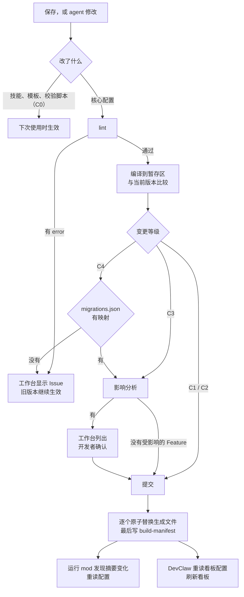

# mods 机制下的插件初始化与热更新（草案）

DevClaw 底层是类 Claude Code 的工具，提供 mods 机制：插件可以带一个钩子模块，拦截工具调用、注册工具和命令、修改系统提示、绘制面板，改了之后热重载。本文讨论有了这个机制后，脚手架的两部分工作怎么做：

1. **初始化新插件**（§3）；
2. **已有插件的热更新与变化**（§4）。

本文是草案，依赖 DevClaw 的 mods 接口，需要确认的事项见 §6。

## 0. 前提与结论

本文假设 DevClaw 的 mods 与 Claude Code 的能力相当，用到以下能力：

| 能力 | 用途 |
|---|---|
| 拦截工具调用：执行前拒绝或改写，执行后读取结果并附加给模型的上下文 | 自动检测、守卫生成文件和状态文件 |
| 注册模型可以调用的工具，并决定是否自动放行 | 脚手架命令（lint、build 等） |
| 读取会话的环境变量 | 确定会话所属的 Feature（`FEATURE_ID` 等）和所选发布单元 |
| 会话开始时执行 | 检查知识仓库是否过期并后台同步（R9） |
| 技能展开时改写技能内容 | 节点开始的触发点；按当前流程注入产物约定，取代 SKILL.md 托管片段 |
| 轮次结束时拦下结束（Stop） | 节点完成的触发点；校验不通过时让模型继续修改 |
| 注册斜杠命令 | `/autobiz new`、`/autobiz open` |
| 面板（含 Input、Select 表单）、确认对话框、状态栏、提示消息 | 插件工作台、建模确认、更新通知 |
| 子代理 | 真实试跑 |
| 读写文件、运行本机命令 | 调用 Python CLI 和运行框架入口 |
| 会话内存储、跨会话存储 | 工作台状态 |
| 插件目录热重载 | 开发态即改即生效 |

结论：

- **mod 不替代核心配置和编译**。插件内容仍然是“核心配置 → lint → 编译配置”，运行期只读编译配置（D19）。mod 改变的是谁来触发、什么时候生效、怎么约束；
- **分两个 mod**。开发 mod 在脚手架这边，包含原来的 `autobiz-plugin-creator` 技能，负责初始化和开发态的热更新；运行 mod 随每个插件发布，是同一份通用代码，根据会话中发生的事自动推进状态，技能对状态无感（§2.3），同时负责守卫和产物约定注入；
- **热更新的难点是在途 Feature 的状态兼容，不是重载本身**。按变更等级处理：不影响状态的修改即改即生效；影响状态的修改先做影响分析；破坏性修改必须带迁移映射。

## 1. 设计原则

| # | 原则 | 原因 |
|---|---|---|
| 1 | 插件内容是数据，mod 是通用解释器。所有插件的运行 mod 代码相同（managed，跟随 `coreVersion`），插件之间只有编译配置不同 | 日常修改只是数据变化，不需要改代码或重载代码；运行 mod 可以统一测试 |
| 2 | 保留编译，改由 mod 自动触发 | 判断状态是否兼容，要比较前后两版编译结果；金样测试、CI、提交前检查都不用变 |
| 3 | `state.json` 仍然只由 `engine.py` 写入 | 不维护 TS、Python 两套状态逻辑；锁、原子替换、校验命令都留在 engine 中 |
| 4 | 开发态放开，发布态设门槛 | 开发者在本机改完马上能看到效果；装到别人那里的插件，破坏性修改必须带迁移 |

## 2. 两个 mod

| | 开发 mod `autobiz-plugin-creator` | 运行 mod |
|---|---|---|
| 位置 | 脚手架仓库；作为 DevClaw 插件装在开发者的环境中 | 每个生成插件的 `runtime/mod/`，随插件发布 |
| 组成 | 原 creator 技能（对话流程、建模指南）+ mod 钩子 | 通用 mod 代码 + build 生成的入口 |
| 归属 | 不随插件发布 | `managed`，入口为 `generated` |
| 负责 | 自动检测、文件归属守卫、脚手架命令工具、建模确认、开发挂载与自动 build、工作台 | 状态文件守卫、技能展开时注入产物约定、感知配置变化、自动推进状态、人工状态操作、看板刷新 |
| 调用 | `autobiz-plugin` CLI（Python） | `runtime/` 下的 Python 入口 |

技能还要保留。怎么和开发者对话、怎么把业务拆成节点，需要模型判断，写在技能里；检测、守卫、确认、生成这些确定的事交给 mod。

下面逐项列出每个 mod 具体做什么、能做到什么程度、有多必要。必要性分三档：

- **P0 必要**：把现在只写在技能里的规则变成宿主强制执行，或者是热更新本身离不开的机制。不做就有正确性风险，或者热更新不成立；
- **P1 值得做**：明显减少出错和等待，但现有做法也能用；
- **P2 体验**：锦上添花，放到最后。

### 2.1 开发 mod

| # | 能力 | 怎么做 | 能做到什么程度 | 必要性 | 不做时 |
|---|---|---|---|---|---|
| A1 | 修改后自动检测 | 在 Edit、Write 上挂执行后钩子：路径落在 `plugin.scaffold.json`、`workflow.json`、`modules/*.json`、`migrations.json` 上时运行 `lint --json`，把 Issue 放进工具结果的附加上下文，模型在同一轮就能读到 | agent 用 Edit、Write 改的，全部覆盖，不靠模型自觉。用 Bash 改的（`sed -i`、重定向），只能从命令文本中识别路径，尽力而为。开发者在编辑器里手改的，mod 收不到文件变化事件，改为每 2 秒比对摘要，结果显示在工作台，下一轮再交给模型 | **P0**：D20 要求“agent 修改后检测”，现在只是技能里的一句话 | 到提交前或 build 前才发现 |
| A2 | 文件归属守卫 | 执行前钩子：目标路径按 `build-manifest.json` 中记录的归属判断，generated、managed、module 文件直接拒绝（内置知识组装脚本除外，插件可以替换它），拒绝理由告诉模型应该改哪个核心配置 | Edit、Write 全部拦住，Bash 尽力而为。在写入之前拦，模型不会白改一轮 | **P0**：为了让检查通过去改生成文件，是模型的常见行为，技能里专门禁止；实现成本很低 | 事后由 `check` 报 `DRIFT_*`，再回滚 |
| A3 | 脚手架命令注册为工具 | 注册 `autobiz_lint`、`autobiz_build`、`autobiz_check`、`autobiz_simulate`、`autobiz_package`、`autobiz_diff`、`autobiz_skills`。mod 一次性确定解释器（`python3`、`python` 或 `py -3`）和脚本路径，用参数数组调用，返回 CLI 的 JSON。这些工具只读写插件目录，自动放行，不弹权限确认 | 模型不再拼命令行，`${pluginPath}` 没替换、Windows 引号、`python` 与 `python3` 混用这些问题都消失 | P1 | 继续用 Bash 调 CLI，能用但容易出错 |
| A4 | 建模确认 | 模型调用 `autobiz_propose_nodes` 提交结构化的节点表，参数按 workflow 节点的 Schema 校验。mod 算出与当前流程的差异和变更等级（§4.3），弹出确认；确认后由 mod 写 `workflow.json` 并检测 | 新建时开发者确认整张表；修改时确认的是差异，例如“删除节点 review，等级 C4，影响 3 个在途 Feature”。JSON 由 mod 写，模型不手写 | P1：流程属于业务决策，现在靠模型自觉询问；修改时给出变更等级和影响尤其有用 | 模型在对话中询问，开发者回答“可以” |
| A5 | 开发挂载与自动 build | lint 通过后按变更等级自动 build（§4.4）；第一次 build 成功后，调用 DevClaw 接口把源目录挂成开发插件 | 保存后几秒内看板就是新的，不用打包、导入 | **P0**（对“随时改”这个目标）：现在的修改循环里最慢的就是打包和重新导入。但这项能力主要在 DevClaw，mod 只负责调用 | 每次修改后打包、导入 |
| A6 | 斜杠命令 | `/autobiz new`、`/autobiz open <目录>`、`/autobiz status`、`/autobiz build`；不需要模型参与的由 mod 直接回答 | `status`、`build` 立即返回，不占用模型轮次 | P1 | 让模型去执行 |
| A7 | 工作台面板 | 显示插件信息、节点表、checkpoint 链、产物流向图（桌面端用 Svg 绘制）、当前 Issue、编译是否过期、变更等级、挂载状态。基础信息用表单（Input、Select）填写，插件 ID 在输入时实时规范化 | 桌面端和终端都能绘制；移动端没有输入框，只能查看 | P2：这些信息 `lint --preview` 都能给出，面板的作用是让变化一眼可见 | 看文本输出 |
| A8 | 真实试跑 | 在沙盒项目中建 Feature，用子代理逐节点执行技能 | 端到端跑出真实产物和状态推进，会消耗真实的模型用量 | P2 | `simulate` 用桩产物模拟 |

开发 mod 还可以在 creator 技能展开时附上当前插件的状态（流程摘要、最近一次检测结果），模型不用先去读文件。

### 2.2 运行 mod

| # | 能力 | 怎么做 | 能做到什么程度 | 必要性 | 不做时 |
|---|---|---|---|---|---|
| R1 | 状态文件守卫 | 执行前钩子：拒绝 Edit、Write 写入 `{metaDir}/` 下的 `state.json`、`.state.lock`、`hooks.ndjson`；Bash 命令中出现这些路径的写操作也拒绝 | Edit、Write 全部拦住，Bash 尽力而为 | **P0**：校验命令只在 engine 推进时执行，模型直接改 `state.json` 就能绕过节点完成判定（D13、D14）。校验反复不通过时，模型确实可能这样做 | 没有防护，只能事后从 `hooks.ndjson` 与 `state.json` 对不上发现 |
| R2 | 技能展开时注入产物约定 | 节点技能被调用时，运行 mod 按当前的 `flow.json` 和 Feature 状态，在技能正文后附上：本节点要读的输入、要写的输出（相对 `FEATURE_DIR` 的路径）及当前是否存在；节点不能开始时附上原因（§2.3）。不含任何状态操作 | 产物约定始终与当前流程一致。SKILL.md 中的托管片段可以取消，build 不再改写开发者的技能文件 | **P0**：自动推进靠“输出写在约定路径上”来判断，路径必须准确送到模型面前；这也是热更新能到达模型的途径。同时可以去掉托管片段和 build-manifest 中的 `regions` | 继续用托管片段，由 build 改写 SKILL.md |
| R3 | 感知配置变化 | 每次自动推进、展开技能之前，比对 `build-manifest.json` 中的摘要；变了就重读编译配置，并提示一次“流程已更新” | 数据热更新就是在这里生效的（§4.2） | **P0**（对热更新） | 改了流程要重开会话 |
| R4 | 自动推进状态 | 节点技能展开时推进到 `_in_progress`；主会话一轮结束时，必需输出都在就推进到 `_done`（含校验命令），校验不通过就拦下结束让模型修改。规则见 §2.3，编码类节点见 §2.8 | 技能完全不写状态操作，模型不知道 checkpoint 的存在；看板与实际一致，不依赖模型记得执行命令 | **P0**：直接解决“每个技能都要手写 update 命令才能推进状态”的问题，也覆盖了“产物写完忘了推进” | 每个技能都要写状态维护说明，能否推进取决于模型 |
| R5 | 人工状态操作 | `/autobiz state` 命令：查看当前状态，重开到某个节点（必须写原因）；内部调用 `update_state.py` | 模型不再持有任何状态工具，例外情况由人处理 | P1 | 只能在看板上操作（如果看板提供） |
| R6 | 看板刷新与产物实时刷新 | 推进成功后通知 DevClaw 刷新看板；会话中的 Write 落在 `FEATURE_DIR` 下时，防抖后通知刷新产物状态 | 可以替代 D21 的本机服务，还顺带实现了 D21 推迟的“产物实时刷新”：那项功能本来就需要知道模型写了哪些文件，运行 mod 正好能看到 | P1，前提是 DevClaw 给 mod 提供看板接口；没有就按 D21 做 | 按 D21 实现本机服务 |
| R7 | 下一步建议 | 节点完成后，把下一个节点的技能（如 `/doc-review`）放进输入框的建议里，按 Tab 采用 | — | P2 | 在看板上点下一个节点 |
| R8 | 开发者扩展 | `entry.ts` 静态导入 `hooks/extension.ts`，开发者可以加自己的面板、命令、守卫 | 给开发者的自由度出口，不用改托管代码 | P2，按需开放：扩展是插件里的任意代码，要和 DevClaw 的权限、审核策略一起定 | 只能用命令钩子 |
| R9 | 知识按需加载 | 会话开始只注入知识索引；模型第一次触达某个发布单元的代码时，附上该单元的知识；节点技能展开时附上节点声明的知识；会话开始时检查知识仓库是否过期，后台同步；引导知识沉淀。组装逻辑仍在 `runtime/knowledge/` 的 Python 中，规则见 §2.4 | 知识占用的上下文从“选了几个单元就全部加载”降到“用到哪个加载哪个”；不用再手动 `pull_knowledge` | P1：现有一次性注入能用，但发布单元多、知识大时挤占上下文，且大部分用不到 | 继续由 `session_context_inject` 一次性注入四层知识 |

刻意不放进运行 mod 的：

- **用修改系统提示来注入流程上下文**：每次状态变化都改系统提示，会让整个提示缓存失效，成本高。会话开始时仍由 `session_context_inject` 注入，之后的变化通过技能展开（R2）和自动推进时附给模型的说明（R4）送达；
- **由 mod 提供看板读取**：没有会话时看板也要显示，而 mod 是随会话加载的（待确认，§6）。

### 2.3 技能对状态无感：自动推进

现在的问题：每个技能都要写“开始时执行 `update_state.py` 推进到 `xx_in_progress`，完成后推进到 `xx_done`”（托管片段）。状态能不能推进，取决于模型有没有照做；改了节点或 checkpoint，还要改写技能。

目标：技能正文里不出现任何状态操作，模型不需要知道 checkpoint、`update_state.py`、`state.json`。运行 mod 根据会话中发生的事推进状态，判定规则仍然在 engine 中。

**会话绑定**：Feature 取自 DevClaw 注入会话的环境变量 `FEATURE_ID`、`PLUGIN_WORKSPACE`、`PROJECT_DIR`（[interfaces.md §3.4](interfaces.md)）；节点由被调用的技能确定（`flow.json` 中技能与节点的对应关系）。同一个技能用在多个节点时，取当前 checkpoint 之后第一个使用它的节点。没有 `FEATURE_ID` 的会话不做任何状态操作。

**触发点**：

| 时机 | 触发事件 | 条件 | 动作 | 条件不满足时 |
|---|---|---|---|---|
| 节点开始 | 节点技能展开：斜杠命令、Skill 工具，或 DevClaw 从看板发起会话时预载的技能 | Feature 停在上一节点的 `_done`，或已经在本节点 `_in_progress`（新建的 Feature 默认停在首节点的 `_in_progress`） | 推进到 `<节点>_in_progress`，engine 检查必需输入 | 不推进；在技能正文后附上原因（例如“缺少输入 PRD.md”“前一步‘起草’还没完成”），模型据此告诉用户 |
| 节点完成 | 主会话的一轮结束（Stop），且本会话没有还在运行的子代理 | `completeOn` 为 `turnEnd` 的节点（编码类节点见 §2.8）；Feature 在本节点 `_in_progress`，本节点的必需输出都已存在 | 推进到 `<节点>_done`：engine 做存在性检查，再执行校验命令。节点声明了 `humanGate` 时，校验通过后先进入“待人工确认”，人通过后才推进（见下文“人工关口”） | 校验不通过：拦下这次结束，把校验输出作为“产物检查未通过”交给模型继续修改。同一节点最多连续自动重试 3 次（入口文件 `runtime.autoRetry`），之后放行，节点保持进行中，看板显示最后一次校验错误 |
| 完成后又改了本节点产物 | 一轮结束时发现本节点输出有改动，Feature 停在本节点 `_done` | — | 重新校验：通过则保持完成；不通过则退回本节点 `_in_progress`，按上一行处理。声明了 `humanGate` 的节点，改动后一律退回，重新校验并重新确认。不影响其他节点 | — |
| 修改上游产物 | 一轮结束时发现已完成的上游节点输出有改动，Feature 已经进入下游节点 | — | 不自动退回。弹出确认，问用户是否退回到该节点（退回后下游节点显示为未开始） | 用户选择不退回时，记一条 `upstream-change` 事件；同一文件的同一次修改只问一次 |
| 打断或出错 | 用户打断，或轮次出错结束 | — | 不推进 | — |

“有改动”由 engine 比较产物文件的修改时间与该 Feature 最近一次状态变更的时间得出，所以模型用 Bash 写的文件也算在内，不依赖 mod 拦截到写入。

**为什么在一轮结束时判断完成**：写完一个文件不代表节点做完了，模型可能还要修改；一轮结束是模型自己认为这一步告一段落的时刻。再加上“必需输出都在、校验通过”两个条件，误判主要出现在一种情况：模型写完产物后在等用户反馈，这时节点会先被标为完成；用户要求修改后，按“完成后又改了本节点产物”重新校验。对这种误判敏感的重要节点，用人工关口卡住。

**人工关口（humanGate）**：在 `workflow.json` 的节点上声明，和 `validate` 一样属于完成判定：

```json
{ "id": "review", "name": "评审", "skill": "doc-review",
  "inputs": ["draft"], "outputs": { "review": "REVIEW.md" },
  "validate": "${python} ${skillPath}/scripts/check_review.py --feature-dir ${featureDir}",
  "humanGate": { "prompt": "请确认评审结论后再进入下一步" } }
```

`humanGate` 写 `true`，或写带 `prompt`（确认时显示的说明）的对象；不写就是没有关口。流程：

1. 输出齐全、校验通过后，不推进到 `_done`，而是在 Feature 记录中写 `gate: {"node": "review", "status": "pending", "since": …}`，看板显示“待人工确认”；
2. 会话中弹出确认：通过、退回（写原因）、稍后。会话已经结束，或者要由别人确认时，在看板上操作，或者用 `/autobiz approve <节点>`、`/autobiz reject <节点> <原因>`；
3. 通过：推进到 `_done`，`hooks.ndjson` 记一条 `human-gate` 事件（决定、确认人、时间）；
4. 退回：保持 `_in_progress` 并清掉 `gate`。会话还在时，原因作为下一条消息交给模型修改；会话已结束时，看板显示原因，下次调用这个节点的技能时附在技能正文后（R2）；
5. 待确认期间产物又被改了：清掉 `gate`，重新校验后再次进入待确认。通过之后又被改了：退回 `_in_progress`，重新走一遍。

自动重试（`runtime.autoRetry`）只针对校验命令，不针对人工关口。谁有权确认由 DevClaw 决定，engine 只记录确认人。

**校验什么时候跑、要多久**：校验命令是开发者写的单行命令，一般是一个脚本，不经过模型；存在性检查只是文件匹配。校验只在两种时刻执行：本节点的输出刚刚齐全，或者已完成节点的产物有改动；其余轮次结束时，`finish` 只看文件在不在。一次检查的开销是启动一次 Python（空解释器实测约 34 ms）加上脚本本身，正常是几十到几百毫秒。`validateTimeoutSec`（默认 120 秒）只是防止脚本卡死的超时上限。只有校验器自己做了重活（跑测试、构建、联网、调用模型）才会慢，所以约定：校验器只做快速、确定的检查；需要模型或人来判断质量的，放在技能里做，或者交给人工关口。

**模型看到什么**：只有业务信息，即输入、输出路径（R2），以及校验不通过时的输出。看不到 checkpoint，也看不到任何状态命令。

**判定放在 engine**：mod 只在事件发生时调用新的入口 `runtime/workflow/auto_state.py`：

```text
python -X utf8 runtime/workflow/auto_state.py start --skill <技能名>   # 节点技能展开时
python -X utf8 runtime/workflow/auto_state.py finish                   # 主会话一轮结束时
```

两个命令都从环境变量定位 Feature，返回：

```json
{ "ok": true, "action": "advanced", "node": "plan", "checkpoint": "plan_done",
  "message": "“任务计划”已完成，下一步是“实现”（/autodev-implement）" }
```

| `action` | mod 怎么做 |
|---|---|
| `advanced` | 刷新看板（R6），提示用户；`finish` 时把下一个节点的技能放进输入建议（R7） |
| `skipped` | 无事发生（会话不属于任何 Feature、技能不对应节点、输出还不齐） |
| `blocked` | `start`：把 `message` 附在技能正文后；`finish`：拦下这次结束，把 `message`（校验输出）交给模型 |
| `ask` | 弹出确认（人工关口、修改上游产物），把用户的选择传回 `auto_state.py decide` |

决策逻辑只有 Python 一份，契约测试可以直接覆盖。不支持 mods 的宿主，只要能在“技能调用”和“轮次结束”时执行命令，也能接入这两个入口。

**模型不再有状态工具**：重开（要写原因）等人工操作，由用户在看板上或用 `/autobiz state` 命令执行（R5），仍然经过 `update_state.py`。R1 的守卫继续阻止模型直接改 `state.json`。

**为什么必须靠 mod**：DevClaw 只知道会话的开始和结束，而一个会话里可能有很多轮，甚至跨几个节点。“技能被调用了”“这一轮结束了”这两个时刻，只有会话里的钩子能拿到。

**兼容**：入口文件的 `plugin.stateMode` 选择状态推进方式：`"auto"`（默认，本节）或 `"skill"`（托管片段，即现有设计），后者给不支持 mods 的宿主使用。迁移进来的旧技能，正文里的状态维护段落在 `auto` 模式下要删掉，`check` 报 `LEGACY_ENTRY_REF` 提示。

**编码类节点**：成果是代码提交、要做很多轮、常由子代理完成的节点，完成判定另有规则，见 §2.8：代码提交作为产物（§2.8.1），在交接时判断完成（§2.8.2），等子代理全部结束再判断（§2.8.3），校验可以跑构建和测试并按提交缓存结果（§2.8.4）。

### 2.4 知识按需加载（R9）

现在的问题：启用知识模块且 `assembler = plugin` 时，`session_context_inject` 在会话开始时把系统级、单元级、会话工作区、领域词汇表四层知识一次性并入 `sessionContext`（[output-spec.md §7.1](output-spec.md)）。选了多个发布单元时，大部分单元级知识在这个会话里用不到，却一直占着上下文；知识仓库要靠 `pull_knowledge` 手动同步；知识沉淀要人想起来去看板上发起。

目标：知识在用到时才进入会话，同步和沉淀不依赖人记得操作。清单解析和组装逻辑不变，仍由知识组装脚本完成（默认为内置的 `render_collected_session_context.py`），只保留一份实现；运行 mod 只决定**什么时候、加载哪一部分**。

**加载方式**：`modules/knowledge.json` 新增 `assembly.loading`：

| 取值 | 行为 | 适用 |
|---|---|---|
| `eager` | 现有行为：会话开始时注入全部四层 | 不支持 mods 的宿主；知识很小的插件 |
| `lazy`（启用运行 mod 时默认） | 会话开始只注入索引，其余按下表触发 | 默认 |

**`lazy` 下的触发点**：

| 时机 | 触发事件 | 加载内容 | 说明 |
|---|---|---|---|
| 会话开始 | `session_context_inject`（仍由 DevClaw 调用） | 系统级知识、领域词汇表、会话工作区层，加上所选发布单元的索引（每个单元一行：ID、名称、描述、`localRepoPath`） | 只在会话开始注入一次，不改系统提示，不影响提示缓存（见 §2.2“刻意不放进运行 mod 的”） |
| 触达发布单元 | Read、Grep、Glob、Edit、Write 的执行后钩子：路径落在某个所选单元的 `localRepoPath` 下 | 该单元的单元级知识，附在这次工具结果的附加上下文里 | 每个单元每个会话只附一次，记录在会话内存储中。类似 Claude Code 进入子目录时加载该目录的 CLAUDE.md。Bash 命令只能按文本识别路径，尽力而为 |
| 模型主动查询 | 注册只读工具 `knowledge_lookup(unit, topic?)`，自动放行 | 指定单元的知识；带 `topic` 时只返回匹配的段落 | 覆盖钩子识别不到的情况，例如模型还没读代码就要先了解某个单元 |
| 节点技能展开 | 与 R2 同一个钩子 | 节点声明的知识：`knowledge.nodes.<节点 id>.include`，知识目录下的相对路径，可用 `${deployUnitId}` 对所选单元逐个展开 | 例如需求分析节点固定带上业务规则文档。未声明时不附加 |

`knowledge_lookup` 和钩子都调用新增的 `runtime/knowledge/lookup.py`，它复用组装器的分层读取，只按单元或主题取一部分。`session_context_inject` 在 `lazy` 下调用组装器的索引模式，`agentmdLoadStatus` 中未加载的单元标为 `"deferred": true`，DevClaw 照常显示。

**同步**（声明了 `knowledge.source` 时）：

- 会话开始时，运行 mod 比对知识目录记录的 ref 与远端；过期时在后台运行 `sync_knowledge.py --write-board-config`，完成后弹提示，新知识从下一个会话起生效（本会话已经注入的索引不变，按需加载的部分读到的是新内容）；
- 比对和同步都有超时，失败只提示，不阻塞会话；同一个插件同时只跑一个同步，沿用 `.knowledge.lock`；
- `pull_knowledge` 宿主命令保留：会话以外（例如看板刷新支持的发布单元）仍要用它。

**知识沉淀**：

- 节点完成（R4 推进到 `_done`）且该节点在 `knowledge.nodes.<节点 id>.sediment` 中声明为 `true`，或 Feature 走完最后一个节点时，把看板配置中的沉淀技能（`knowledge_config.nextAction.slashSkill`，默认 `knowledge-sync`）放进输入框建议，与 R7 同一机制；
- 守卫：声明了 `knowledge.source` 时，知识目录是同步缓存，下次同步会覆盖。Edit、Write 写入该目录一律拒绝，拒绝理由告诉模型改走知识沉淀流程。未声明 `source` 时，知识目录是开发者资源，不加守卫（开发态由 A2 按归属处理）。

**不搬进 mod 的**：

- 看板上支持的发布单元列表：建 Feature 时还没有会话，mod 不在（§2.5），继续由 build 和 `pull_knowledge` 预先生成；
- `assembler = devclaw`：知识段由 DevClaw 组装，运行 mod 只提供 `knowledge_lookup` 和沉淀引导，不改会话开始的注入；
- 组装逻辑本身：不用 TS 重写，理由同 §1 原则 3。

**依赖**：运行 mod 要知道本会话选了哪些发布单元。现在 `create_feature` 不保存发布单元，每次会话由宿主作为参数传给 `session_context_inject`（[interfaces.md §3.3.7](interfaces.md)），mod 拿不到。需要 DevClaw 提供（§6 第 11 项）。

### 2.5 做不到或只能尽力而为的

| 限制 | 影响 | 对策 |
|---|---|---|
| Bash 命令只能按文本识别路径 | A1、A2、R1 拦不全 `sed -i`、重定向、脚本内部的写文件 | 守卫以 Edit、Write 为主；可选：engine 发现 `state.json` 与 `hooks.ndjson` 中最后一次推进对不上时报警 |
| mod 收不到文件变化事件 | 开发者在编辑器里手改，不能立刻检测 | 每 2 秒比对核心配置的摘要 |
| mod 随会话加载 | 没有会话时 mod 不工作 | 看板读取保留 inspectCommands；会话以外的写入口（`create_project`、`create_feature`）由 DevClaw 直接调用 |
| 判断不了产物内容 | 业务产物是否合格，mod 管不了 | 仍由节点校验命令负责 |
| “完成”是推断出来的 | 自动推进按“一轮结束 + 输出齐全 + 校验通过”判断完成，模型写完产物后等用户反馈时会先被标为完成 | 重要节点声明 `humanGate`，人通过后才算完成；其他节点产物再改时重新校验（§2.3） |
| 编码类节点要等交接才判断完成 | 用户一直不进入下一步、也不关闭会话时，节点停在进行中 | 看板显示预检查结果（§2.8.2）；用户可以点“完成” |
| 移动端没有输入框 | 工作台表单在移动端不可用 | 移动端只读 |
| 接口还在变化 | Claude Code 的 mods 接口标注为 early access，DevClaw 的版本节奏未知 | 运行 mod 声明所需的宿主接口版本；`check` 的契约测试覆盖运行 mod |
| 会话压缩后知识丢失 | R9 按需附上的单元知识随压缩被摘要掉，而“每单元只附一次”的记录还在，再次触达时不会重新附上 | mod 能收到压缩事件时清空记录；收不到时靠 `knowledge_lookup` 让模型自己重新查 |

### 2.6 分期建议

| 期 | 开发 mod | 运行 mod | 依赖 DevClaw 的 |
|---|---|---|---|
| 一 | A1 自动检测、A2 文件归属守卫、A3 命令工具、A6 斜杠命令 | R1 状态文件守卫、R2 产物约定注入、R3 感知配置变化、R4 自动推进、R5 人工状态操作 | 只需要通用的 mods 能力 |
| 二 | A4 建模确认、A5 开发挂载与自动 build | R6 看板刷新、R9 知识按需加载、R4 的编码类节点规则（§2.8） | 源目录挂载、给 mod 的看板接口；A4 还依赖 CLI 的 `diff`；R9 和 §2.8 的 `repos: "deployUnits"` 依赖 mod 能拿到所选发布单元；§2.8 还依赖子代理和会话结束事件 |
| 三 | A7 工作台面板、A8 真实试跑 | R7 下一步建议、R8 开发者扩展 | 子代理、扩展代码的权限策略 |

第一期做完，技能里不再有任何状态操作，规则也从“写给模型看”变成“宿主强制执行”，SKILL.md 不再被 build 改写；第二期做完，开发态的“改完就生效”才真正成立。

### 2.7 插件目录的变化

在 [output-spec.md §1](output-spec.md) 的基础上增加：

```text
<plugin>/
├── plugin.json                     # generated  新增 "hooks": "./runtime/mod/hooks.json"
├── migrations.json                 # developer  状态迁移映射，需要时才有（§4.5，不随包发布）
├── hooks/extension.ts              # developer  可选：开发者自己的 mod 钩子（plugin.modExtension 声明）
└── runtime/
    ├── mod/
    │   ├── hooks.json              # generated  {"modules": ["./entry.ts"]}
    │   ├── entry.ts                # generated  静态导入运行 mod 和开发者扩展
    │   └── runtime.ts              # managed    通用运行 mod
    └── config/
        └── migrations.json         # generated  编译后的迁移表，随包发布
```

一个插件只能有一个钩子模块，模块中也不能动态导入，所以由生成的 `entry.ts` 静态导入运行 mod 和开发者扩展。开发者扩展不能注册与运行 mod 同名的工具，也不能拦截运行 mod 用来自动推进的事件（build 报 `MOD_EXTENSION_CONFLICT`）。

运行 mod 每个插件带一份，而不是做成所有插件共用的一个 DevClaw 插件。这样各插件可以停在不同的框架版本上，与现在 `runtime/` 的做法一致。同一个会话加载了多个插件的运行 mod 时，工具名带插件前缀，各自的守卫只管自己的 `{metaDir}`。

### 2.8 长时间节点：编码与子代理

像 lite 的 `dev.code`（增量编码）这类节点，§2.3 的规则不够用：

| 特点 | 对“一轮结束 + 输出齐全 + 校验通过”的影响 | 对策 |
|---|---|---|
| 成果是代码仓库里的提交，不是 `FEATURE_DIR` 下的文件（lite 的 `dev.code` 连 `outputs` 都没有） | 没有输出可查，第一轮结束就会被判完成 | 代码提交作为产物（§2.8.1） |
| 要做很多轮，中途就会提交 | 第一次提交之后，每一轮结束都可能被误判完成 | 在交接时判断完成（§2.8.2） |
| 常由子代理写代码，可能在后台运行，或在独立的工作树里 | 主会话一轮结束时，子代理可能还在跑；提交可能在还没合并的分支上 | 等会话静止再判断，检查未合并的工作树（§2.8.3） |
| 校验一般是构建和测试 | 比检查文档慢，不适合每轮都跑 | 只在判断完成时跑，结果按提交缓存（§2.8.4） |

四部分可以分开用：只想让代码节点不被误判，用 §2.8.1 + §2.8.2 就够；有子代理时加上 §2.8.3；要在完成前跑测试再加 §2.8.4。

#### 2.8.1 代码提交作为产物

> git 产物的写法、基线和齐全条件已并入核心设计（[input-config.md §2.9](input-config.md)、[output-spec.md §4.2、§4.4](output-spec.md)），不依赖运行 mod：没有 mod 时由 `update_state.py` 推进到 `_in_progress`、`_done` 时记录基线和检查。下面保留完整说明，运行 mod 在此基础上增加交接时机（§2.8.2）和会话静止（§2.8.3）。

`outputs` 中可以声明 git 类型的产物，与文件产物并列：

```json
"outputs": {
  "code": { "git": { "repos": "deployUnits" } },
  "summary": "implementation.md"
}
```

同一个节点可以同时有 git 产物和文件产物，全部齐全才算产物齐全。`git` 对象的字段：

| 字段 | 默认 | 说明 |
|---|---|---|
| `repos` | `"deployUnits"` | 看哪些仓库。`"deployUnits"`：本 Feature 所选发布单元的 `localRepoPath`（§2.4），依赖 mod 拿到所选发布单元（§6 第 11 项），没有启用知识模块时必须显式写；`"project"`：项目目录本身就是仓库；或者写相对项目目录的路径数组。不写绝对路径（D15） |
| `branch` | `"current"` | 基线分支。`"current"`：节点开始时各仓库检出的分支；也可以写分支名，可用 `${feature}`，例如 `"feature/${feature}"` |
| `require` | `["commits", "clean", "merged"]` | 齐全条件，取下表的子集；`"pushed"` 默认不要求 |

发布单元的 `localRepoPath` 是某个仓库的子目录时（单仓库多模块），下表的检查都只看这个子目录。

**基线**：节点开始（`auto_state.py start`）时，engine 为每个仓库记下当前分支、HEAD 和已有的工作树，写进 Feature 记录：

```json
"git": {
  "dev.code": {
    "repos": {
      "LF39.18_wg_flow": {
        "path": "wg_flow",
        "branch": "feature/f1",
        "base": "a1b2c3d",
        "worktrees": ["/…/wg_flow"],
        "done": null
      }
    }
  }
}
```

`path` 相对项目目录。节点完成时，`done` 记下当时的 HEAD。重开节点时保留 `base`、清空 `done`，所以重开后之前的提交仍然算数。

**齐全条件**：

| 条件 | engine 怎么查 | 不满足时给出的原因 |
|---|---|---|
| `commits` | `git rev-list --count <base>..<branch>`，至少一个仓库大于 0 | “还没有新提交” |
| `clean` | `git status --porcelain` 为空，`.gitignore` 忽略的文件不算 | 列出未提交的文件，最多 20 个 |
| `merged` | 当前工作树列表中，基线之后新增的工作树，其分支上不能有不在 `<branch>` 上的提交（`git rev-list <branch>..<工作树分支>` 为空） | 列出未合并的工作树和分支 |
| `pushed` | `git rev-list @{u}..<branch>` 为空 | “有 N 个提交未推送” |

另外，仓库当前检出的分支与基线不同时，原因里会提示（例如“wg_flow 当前在 fix-log，开始时在 feature/f1”），因为提交可能落在了别的分支上。每个仓库只跑几条 git 命令，耗时几十毫秒。

**看结果，不看过程**：engine 直接查仓库状态，不靠拦截 `git commit`。所以主会话、子代理，甚至用户在终端里做的提交都算；`amend`、`rebase` 之后也照样能判断。这与 §2.3 用修改时间判断“有改动”是同一个原则。

**给下游节点用**：git 产物也可以作为后面节点的输入，例如评审节点 `"inputs": ["code"]`。输入是否存在，看上游节点完成时记录的提交范围（`base..done`）是否非空。R2 展开下游节点的技能时，把每个仓库的提交范围附在正文后，评审技能据此查看 diff，不用自己去找改了什么。

#### 2.8.2 完成时机 completeOn

| 取值 | 什么时候判断完成 | 默认用于 |
|---|---|---|
| `turnEnd` | 主会话一轮结束、会话静止时（§2.3 的触发点表） | 只有文件产物的节点 |
| `handoff` | 交接时（下表） | 有 git 产物，或者没有任何产物的节点 |

两种取值都可以显式写在节点上。代码节点写 `turnEnd` 就是“自主模式”：每次有新提交的轮次结束都判断，校验不通过就拦下结束让模型继续改，直到通过或重试次数用完（`runtime.autoRetry`），适合全自动的编码代理。默认的 `handoff` 不会这样逼着模型继续，适合边做边和用户讨论的场景。

**交接的触发点**：

| 触发 | 怎么发现 | 判定通过 | 判定不通过 |
|---|---|---|---|
| 主会话调用下一个节点的技能 | 技能展开事件；Feature 停在本节点 `_in_progress`，被调用的技能属于紧接着的下一个节点 | 连推两步：本节点 `_done`，下一节点 `_in_progress` | 下一节点不开始；原因附在下一节点的技能正文后，模型据此处理或告诉用户 |
| 会话结束 | 会话结束事件（包括 `/clear`） | 推进到 `_done` | 保持进行中，看板显示原因 |
| 看板上点“完成” | DevClaw 调用插件（[rpc.md](rpc.md) 新增方法，或兜底命令），由 `auto_state.py finish --trigger manual` 处理 | 推进到 `_done` | 看板弹出原因 |
| `/autobiz done` | 会话中的斜杠命令（R5） | 推进到 `_done` | 命令输出原因；加 `--revalidate` 时忽略缓存重跑校验（§2.8.4） |

- 调用的是隔了几个节点的技能时，不算交接，按 §2.3 的“节点开始”规则处理（前一步没完成，不开始）；
- 最后一个节点没有下一个节点，只能靠后三种触发；
- 声明了 `humanGate`（例如代码评审）时，判定通过后先进入待人工确认。如果是调用下一节点技能触发的，当场弹出确认，通过后再连推两步。

**预检查**：`handoff` 节点每次会话静止时做一次预检查，只查 §2.8.1 的 git 条件，不跑校验命令，不推进状态。结果写进 `feature_status` 的输出（新增 `readiness`，见 §5），看板据此显示“代码已提交，可以进入下一步”或“wg_flow 有 3 个文件未提交”，状态栏也同步显示。预检查的结果不告诉模型，技能对状态仍然无感。

#### 2.8.3 子代理

**会话静止**：判断完成（`turnEnd`）、预检查、会话结束时的交接，都要等会话静止，即主会话一轮结束，并且本会话启动的子代理（包括后台运行的）都已结束。

- 运行 mod 在子代理启动时计数加一，子代理的一轮结束时减一；
- 主会话一轮结束时还有子代理在跑，就推迟判断。类 Claude Code 的宿主在后台子代理结束后会唤醒主会话，到那一轮结束时再判断；宿主不唤醒时，在下一次主会话轮次结束或会话结束时判断；
- 会话结束时如果还有子代理在跑，按会话结束那一刻的仓库状态判断。

**哪些事件不算数**：

| 事件 | 处理 | 原因 |
|---|---|---|
| 子代理结束 | 不是判断点 | 主会话可能还会继续派活 |
| 子代理调用节点技能 | 只按“节点开始”规则推进到 `_in_progress`，不触发交接 | 主代理在编码中途派一个“评审”子代理，不应该把编码节点推成完成 |
| 子代理的校验不通过 | 不拦子代理的结束 | 只拦主会话的结束，由主代理决定怎么处理 |

**独立工作树**：子代理在独立工作树里提交时，提交落在工作树的分支上。主代理把分支合并回基线分支之前，`merged` 条件不满足，原因里列出这些工作树和分支。合并后提交到了基线分支上，`commits` 条件满足。

**守卫同样生效**：子代理的工具调用同样经过 R1、A2 的守卫，子代理也改不了 `state.json` 和生成文件。

v1 只认主会话交接。以后要让子代理承担整个节点（例如 `agentMode` 为 `workflow`、`agent_team`，每个节点由一个子代理完成），再增加按子代理交接的规则。

#### 2.8.4 代码类节点的校验

**什么时候跑**：只在判断完成时跑，即 `handoff` 的交接触发，或 `turnEnd` 下本轮有新提交时。预检查不跑。所以校验命令可以跑构建和测试。

**新增的占位符和字段**：

| 名称 | 说明 |
|---|---|
| `${repos}` | 本节点 git 产物涉及的仓库（或子目录）绝对路径，JSON 数组 |
| `${gitRanges}` | 每个仓库的提交范围，JSON 对象，例如 `{"LF39.18_wg_flow": "a1b2c3d..9f8e7d6"}`，校验器可以只检查改动部分 |
| 节点的 `validateTimeoutSec` | 覆盖全局的 `runtime.validateTimeoutSec`（默认 120 秒），给测试留够时间 |

校验命令的工作目录仍是 Feature 的产物目录（[interfaces.md §4.4](interfaces.md)），仓库通过占位符传入。校验期间状态栏显示“正在校验‘增量编码’（已运行 35 秒）”；用户打断时结束校验进程，不推进。

**结果缓存**：缓存键是“替换占位符后的校验命令 + 各仓库 HEAD”，结果存在 Feature 记录的 `lastValidation` 中（键、是否通过、退出码、时间、输出末尾）。再次判断时键没变，就直接用上次的结果，通过和不通过都复用，不重跑测试，原因里注明“没有新提交，沿用上次结果”。测试不稳定时，用 `/autobiz done --revalidate` 强制重跑。

**校验器一般检查什么**：

| 检查 | 示例 |
|---|---|
| 计划任务都做完了 | 读 `${featureDir}/plan.md`，所有 `- [ ]` 都已勾选 |
| 能构建 | `mvn -q compile`、`npm run build` |
| 测试通过 | 只跑 `${gitRanges}` 涉及的模块的测试 |
| 代码规范 | 只对改动的文件跑 lint |
| 已推送、CI 通过 | 用 `git` 查远端，或用 `gh` 查 CI 状态。要联网，注意超时 |

**约定**：

- 校验器只读：不改代码，不提交（[interfaces.md §4.4](interfaces.md)）；
- 构建产生的文件要在 `.gitignore` 中，否则下次判断时 `clean` 条件会不满足；
- 一个命令处理全部仓库，按 `${repos}` 逐个检查，在输出末尾写清哪个仓库、哪一项没通过。

`auto` 模式下，一个节点既没有产物也没有校验命令时，完成只能靠交接或人工决定，`lint` 报 `AUTO_NO_EVIDENCE`（warning），提示补上 git 产物或校验命令。

#### 2.8.5 示例

假设在 lite 的 `dev.code` 后面加了一个评审节点 `dev.review`（技能 `autodev-review`，`"inputs": ["code"]`），`dev.code` 按 §2.8.1 的示例声明 git 产物、`completeOn: "handoff"`，校验命令跑构建和测试：

| # | 发生了什么 | 运行 mod / engine | 状态 |
|---|---|---|---|
| 1 | 用户在看板上从“增量编码”发起会话，预载 `/autodev-code` | 节点开始：输入齐全，记录基线（wg_flow：`feature/f1@a1b2c3d`） | `code_in_progress` |
| 2 | 主代理派出两个子代理写代码，其中一个用独立工作树；自己做第三个任务 | 子代理计数为 2 | — |
| 3 | 主会话一轮结束，子代理还在跑 | 推迟判断 | — |
| 4 | 子代理都结束；主代理合并工作树分支并提交 | 预检查：5 个新提交，工作区干净，没有未合并的分支；看板显示“可以进入下一步” | — |
| 5 | 用户说“日志格式再改一下”，模型改完没有提交，这一轮就结束了 | 预检查：wg_flow 有 2 个文件未提交 | — |
| 6 | 用户调用 `/autodev-review` | 交接：`clean` 不满足，下一节点不开始；评审技能正文后附上“wg_flow 有 2 个文件未提交” | 仍是 `code_in_progress` |
| 7 | 模型提交后，用户再次调用 `/autodev-review` | 交接：git 条件满足，运行校验（构建和测试，48 秒），通过，连推两步 | `code_done` → `review_in_progress` |
| 8 | 评审技能展开 | R2 附上提交范围 `a1b2c3d..9f8e7d6` | — |

整个过程中，`autodev-code` 和 `autodev-review` 两个技能都没有写任何状态操作。

## 3. 第一部分：初始化新插件

### 3.1 用到的能力

新建插件主要用开发 mod 的 A1～A7（§2.1）。从使用者的角度看，与现在的 creator 技能（[interfaces.md §1.6](interfaces.md)）相比：

| 环节 | 现在 | mods 下 |
|---|---|---|
| 发起 | 触发 `/autobiz-plugin-creator` 技能 | `/autobiz new` 打开工作台，模型按技能开始对话 |
| 基础信息 | 模型逐项问答 | 工作台表单，插件 ID 实时规范化 |
| 调用脚本 | 模型拼 `python3 "${pluginPath}/…"` | 调用注册好的工具（A3） |
| 写 `workflow.json` | 模型确认后手写 JSON | 模型提交节点表，开发者确认后由 mod 写入（A4） |
| 检测 | 技能规定每次修改后运行 | 修改后自动执行（A1） |
| 试跑 | 打包、导入 DevClaw，或 `simulate` | 挂载为开发插件直接试（A5）；`simulate` 保留给 CI |

### 3.2 流程

| 步骤 | 开发者 | 开发 mod / 模型 | 产出 |
|---|---|---|---|
| 1. 发起 | `/autobiz new` | 打开工作台 | — |
| 2. 基础信息 | 填表单 | 调用 `new --yes` 建骨架 | `plugin.scaffold.json`、目录 |
| 3. 盘点技能 | 指定技能来源 | 列出、导入技能，工作台显示技能卡片 | `skills/<技能>/` |
| 4. 建模 | 用自己的话描述流程 | 模型整理节点表，提交到工作台 | 待确认的节点表 |
| 5. 确认 | 点“确认写入”，或要求修改 | mod 按表写入，自动 lint | `workflow.json` |
| 6. 模块 | 回答看板、会话、知识的问题（表单加对话） | 写需要的模块文件，自动 lint | `modules/*.json` |
| 7. 生成并挂载 | — | lint 没有 error 后自动 build，挂载为开发插件 | 看板上出现新插件 |
| 8. 试跑 | 在沙盒项目中建 Feature，逐节点运行 | 工作台显示状态推进和校验结果 | — |
| 9. 发布 | 确认版本 | 调用 `package` | zip |

和现有的 creator 技能（[interfaces.md §1.6](interfaces.md)）相比，步骤不变，变化有四点：

- 结构化字段用表单填写，确认用按钮；
- `workflow.json` 由 mod 按确认后的表写入，模型不手写 JSON；
- 检测和生成自动触发；
- 试跑直接在 DevClaw 中进行，不用打包导入。

修改已有插件也从工作台进入（`/autobiz open <目录>`），之后的流程见第二部分。

## 4. 第二部分：已有插件的热更新与变化

### 4.1 两种场景

| 场景 | 插件从哪里加载 | 谁来改 | 怎么生效 |
|---|---|---|---|
| 开发态 | 开发者本机，DevClaw 挂载源目录 | 开发者手改或让 agent 改 | 保存后自动检测、编译、生效（§4.4） |
| 发布态 | 其他人的 DevClaw，安装的是发布包 | 开发者发布新版本 | 更新插件后生效，在途 Feature 按迁移表迁移（§4.7） |

两种场景用同一套变更等级（§4.3）。

### 4.2 数据热更新与代码热更新

| | 数据热更新 | 代码热更新 |
|---|---|---|
| 改了什么 | 编译配置、技能、模板、校验脚本 | 运行 mod（框架升级）、开发者扩展 `hooks/extension.ts` |
| 频率 | 每次日常修改 | 很少 |
| 怎么生效 | 运行 mod 每次使用配置前比对 `build-manifest.json` 中的摘要，有变化就重读编译配置，mod 本身不重载 | DevClaw 的插件目录热重载：重新执行 `register`，会话存储保留，模块内的变量重置 |

数据热更新不依赖 mod 重载。Claude Code 只在钩子模块自己的源文件变化时重载，配置文件变化不会触发；DevClaw 的行为待确认，所以这里不依赖它。

### 4.3 变更等级

build 编译出新流程后，与当前的 `runtime/config/flow.json` 比较，得出变更等级（`autobiz-plugin diff` 单独输出这个结果）。等级决定开发态能否自动生效，以及发布态要升哪一位版本号。

| 等级 | 典型修改 | 对在途 Feature 的影响 | 开发态 | 发布态 |
|---|---|---|---|---|
| C0 资源 | 技能正文（托管片段以外）、模板内容、校验脚本内容、`references/`、`agents/*.md` 内容 | 无 | 不需要 build，下次调用或下次会话生效 | patch |
| C1 展示 | 节点显示名和描述、产物显示名、`nextAction` 文案、阶段名 | 无 | 自动 build，看板重读 | patch |
| C2 策略 | `session.policies`、子代理、知识配置、看板可选能力的开关 | 只影响新会话 | 自动 build，新会话生效 | minor |
| C3 流程扩展 | 追加或插入节点，给节点加输入或输出，改校验命令、产物路径 | checkpoint 仍然有效，但可能有 Feature 推进不了 | build 后做影响分析（§4.5）：没有受影响的 Feature 就自动生效；有就在工作台列出，开发者确认后生效 | minor |
| C4 流程破坏 | 删除节点，改节点 id 的最后一段（checkpoint 名随之变化），调整节点顺序 | checkpoint 不存在或含义改变，按现有规则 `state.json` 会拒绝写入（[output-spec.md §4.2](output-spec.md)） | 必须在 `migrations.json` 中写迁移映射，否则不生效（`FLOW_BREAKING`） | major，必须带迁移 |
| C5 身份 | `plugin.id`、`runtime.layout` | 状态找不到 | 禁止（`PLUGIN_ID_CHANGED`、`LAYOUT_CHANGED`） | 禁止 |
| 框架升级 | `coreVersion`、模块版本 | 可能涉及 `state.json.schemaVersion` | `upgrade` 后代码热更新 | 跟随框架版本 |

C3 与 C4 的判定规则：旧 checkpoint 链是新链的子序列（顺序不变，只增不减）就是 C3，否则是 C4。

### 4.4 开发态的更新流水线



规则：

- 检测没通过或者等级不允许时，旧版本继续生效，不会出现一半新一半旧；
- 编译先写暂存区，提交时逐个原子替换，`build-manifest.json` 最后写。运行 mod 和 DevClaw 以 manifest 为准：manifest 中的摘要与文件对不上时（提交到一半），继续用旧配置；
- engine 一次推进只读 `flow.json` 一个文件，所以单次推进看到的一定是同一版流程；
- 手动修改：开发 mod 拦截不到编辑器保存，改为每 2 秒比对一次核心配置的摘要，或者使用 DevClaw 提供的文件变化事件（如果有）；
- 工作台可以关闭自动 build，关闭后只提示 `BUILD_STALE`。

### 4.5 在途 Feature：flowRev 与迁移

`state.json` 中每个 Feature 增加 `flowRev` 字段，记录它创建时或最近一次推进时的流程版本（checkpoint 链的摘要）。只有 C3、C4 会改变 flowRev。

迁移映射写在开发者的 `migrations.json` 中，由入口文件引用，build 编译到 `runtime/config/migrations.json` 并随包发布：

```json
{
  "$schema": "./.scaffold/migrations.schema.json",
  "steps": [
    {
      "from": "rev:3f2a9c1e",
      "renameNodes": { "plan": "design" },
      "removeNodes": { "review": "design_done" },
      "remapCheckpoints": { "test_done": "deploy_in_progress" }
    }
  ]
}
```

| 字段 | 含义 |
|---|---|
| `from` | 这一步适用的旧版本。build 报 `FLOW_BREAKING` 时会给出当前的 rev，照抄即可；这一步的目标版本由 build 记录 |
| `renameNodes` | 旧节点 id → 新节点 id，两个 checkpoint 按 `_in_progress`、`_done` 一一对应 |
| `removeNodes` | 被删除的节点 → 停在这个节点上的 Feature 移到哪个 checkpoint |
| `remapCheckpoints` | 其余情况（例如调整顺序）逐个映射 |

迁移怎么执行：

- **读取**（看板查询、会话上下文）：`query.py` 在内存中按迁移表换算后展示，不写文件；
- **写入**（推进、重开）：`engine.py` 在锁内先迁移这个 Feature，再执行推进，并在 `hooks.ndjson` 中写一条 `state-migrate` 事件；
- 换算后仍然不在当前流程中的 checkpoint，对应的 Feature 标记为“流程已变化”：看板显示原因，推进被拒绝，直到开发者补上映射；
- C3 不需要映射：旧链是新链的子序列，原来的 checkpoint 都有效，只更新 `flowRev`。

**影响分析**检查的是：每个在途 Feature 按新流程走，下一次推进需要的产物是否都在。例如在某个 Feature 当前位置之前插入了新节点，而后面的节点要读新节点的产物，这个 Feature 就会推进不了。检查范围在开发态是 DevClaw 中挂载了该插件的项目（需要 DevClaw 提供项目列表，或者开发者在工作台中选），在发布态是使用者加载新版本时自己的项目。

### 4.6 会话进行中发生更新

| 情况 | 处理 |
|---|---|
| C1、C2 | 展示类变化不需要告诉模型；C2 的会话策略只影响新会话 |
| C3 | 下一次展开技能时说明已经是新的（R2）；当前节点的输入或输出变了时，提示开发者一次，并在下一次工具结果中告诉模型 |
| C4，当前 Feature 已迁移 | 自动推进按新流程判断；当前节点被删除或改名时，按迁移表落到新的 checkpoint，并提示用户一次。模型不接触 checkpoint，不受影响 |
| 代码热更新 | 运行 mod 重新执行 `register`；正在进行的推进由 engine 的锁保证完整 |

### 4.7 发布态更新

- `package` 按变更等级检查版本号：C4 必须升主版本并带迁移步骤，否则报 `MIGRATION_MISSING`；其他等级版本号升得不够时报 `VERSION_BUMP`（warning）；
- 打包时把本版本的 flowRev 记进 `runtime/config/migrations.json` 的历史，用来判断使用者的旧 Feature 来自哪个版本；
- 使用者更新插件后：框架版本有变化时代码热更新，配置按数据热更新生效，在途 Feature 按 §4.5 在下次写入时迁移；
- 回滚：C0～C2 可以直接装回旧版本；C3 回滚后，已经走到新增节点上的 Feature 在旧版本中推进不了；C4 不支持回滚，旧版本不认识迁移后的 checkpoint。

## 5. 对现有设计的影响

| 位置 | 改动 |
|---|---|
| D9、[interfaces.md §1.6](interfaces.md) | creator 从技能改为插件：技能 + 开发 mod |
| D16、[output-spec.md §1](output-spec.md) | 新增 `runtime/mod/`；`plugin.json.hooks` 指向运行 mod；开发者的 mod 钩子放在 `hooks/extension.ts`，由 `plugin.modExtension` 声明 |
| D11、D19 | 运行期只读编译配置不变；`workflow.json` 的节点增加 `humanGate`、`completeOn`，与 `validate` 同属完成判定 |
| D12、D13 | 产物除了文件路径，还可以是 git 类型（代码提交），存在性由 engine 查仓库状态判断（§2.8.1）；[examples/lite/](../examples/lite/) 的 `dev.code` 补上 git 产物 |
| D20 | “agent 修改后”这一环由开发 mod 的钩子保证；提交前检查和 CI 不变 |
| D21 | 会话中的推送改为运行 mod 直接通知 DevClaw，并增加产物实时刷新（R6）；DevClaw 不给 mod 提供看板接口时才保留本机服务 |
| [README §4](README.md) | 托管片段取消后，seeded 的 SKILL.md 不再有 build 维护的区域 |
| [output-spec.md §4.2](output-spec.md) | Feature 增加 `flowRev`、人工关口的 `gate`，以及 git 产物用的 `git`（各仓库基线和完成时的 HEAD）、`lastValidation`（§2.8）；“checkpoint 不在当前配置中时拒绝写入”改为先查迁移表 |
| [output-spec.md §6.1](output-spec.md) | 取消 `state`、`artifacts` 托管片段，改为技能展开时注入（R2）；只在需要兼容不支持 mods 的宿主（例如开启 `codexManifest`）时保留 |
| [output-spec.md §8](output-spec.md) | build-manifest 去掉 `regions` |
| [interfaces.md §4.2](interfaces.md) | `update_state.py` 改为人工和宿主使用的状态入口，不再由模型调用；增加迁移步骤。新增 `auto_state.py`（§2.3） |
| [output-spec.md §4.3](output-spec.md) | `update-state` 事件增加 `trigger`：`auto-start`、`auto-finish`、`manual`；新增 `upstream-change` 事件（用户选择不退回时）和 `human-gate` 事件（人工关口的决定） |
| [interfaces.md §3.3.4](interfaces.md) | `feature_status` 新增 `readiness`：`handoff` 节点的预检查结果（是否可以交接、原因列表），§2.8.2 |
| [rpc.md §5.2](rpc.md) | 看板“完成”按钮需要一个方法（例如 `state/complete`），由 `auto_state.py finish --trigger manual` 处理（§2.8.2） |
| [interfaces.md §1.1](interfaces.md) | 新增 `autobiz-plugin diff`：输出变更等级和影响分析，开发 mod 和 `package` 都使用 |
| [input-config.md §4.3](input-config.md)、[schemas/modules/knowledge.schema.json](../schemas/modules/knowledge.schema.json) | `knowledge.json` 新增 `assembly.loading`（`eager` / `lazy`）和 `nodes.<节点 id>.include`、`nodes.<节点 id>.sediment`（§2.4）；`nodes` 中的节点 id 必须存在于 `workflow.json` |
| [output-spec.md §7.1](output-spec.md) | 知识模块新增 `runtime/knowledge/lookup.py`；内置组装脚本增加索引模式；声明 `source` 时运行 mod 会话开始自动同步，`pull_knowledge` 保留给会话以外使用 |
| [interfaces.md §3.3.7](interfaces.md) | `loading = lazy` 时 `sessionContext` 的知识段只有系统级、词汇表、会话工作区和发布单元索引；`agentmdLoadStatus` 中未加载的单元带 `"deferred": true` |
| [input-config.md](input-config.md) | 新增 `migrations.json`、`plugin.modExtension`、`plugin.stateMode`、`runtime.autoRetry`，节点新增 `humanGate`、`completeOn`、`validateTimeoutSec`，`outputs` 支持 git 类型的产物，校验命令新增占位符 `${repos}`、`${gitRanges}`（§2.8）；自动模式下技能正文中出现 `update_state.py` 调用时报 `LEGACY_ENTRY_REF`；新增检查规则 `FLOW_BREAKING`、`MIGRATION_MISSING`、`CHANGE_IMPACT`、`VERSION_BUMP`、`MOD_EXTENSION_CONFLICT`、`AUTO_NO_EVIDENCE` |

## 6. 需要 DevClaw 确认

1. mods 接口与 Claude Code 有哪些差异，§0 表中的能力是否都有，特别是拦截工具调用并附加上下文、注册工具并自动放行、技能展开时改写内容、Stop 时拦下结束、面板表单，以及在 mod 中运行本机 Python；
2. 能否从源目录挂载开发插件并监听变化（类似 Claude Code 的 `--plugin-dir`），重载时是否同时重读 `plugin.json`、`board_config.json` 和技能；
3. 能否给 mod 提供看板接口，用来刷新指定项目或 Feature 的看板（替代 D21 的推送）；
4. mod 的生命周期是只随会话加载，还是有会话以外的常驻部分。这决定看板读取能否从 inspectCommands 改为由 mod 提供；
5. mod 能否读到会话的环境变量 `FEATURE_ID`、`PLUGIN_WORKSPACE`、`PROJECT_DIR`（[interfaces.md §3.4](interfaces.md)），自动推进（§2.3）靠它们确定 Feature；DevClaw 从看板发起会话、预载节点技能时，是否同样触发技能展开事件；
6. 插件的 mod 在哪些会话中加载：只在该插件发起的会话中，还是所有会话都加载。这影响守卫的作用范围和多插件隔离（D3）；
7. 插件清单的 `hooks` 能否同时挂运行 mod 和开发者的命令钩子；
8. 发布态插件怎么更新，新版本加载失败时能否回退到上一版；
9. 开发态做影响分析需要知道哪些项目用了这个插件，DevClaw 能否提供项目列表；
10. 看板能否显示节点“待人工确认”并提供通过、退回按钮（`humanGate`，§2.3），确认人怎么识别、谁有权确认；
11. 运行 mod 怎么拿到本会话所选的发布单元（R9，§2.4）。可选：DevClaw 注入环境变量（例如 `SELECTED_DEPLOY_UNITS`，内容同 `${selectedDeployUnits}`）；或者 `create_feature` 改为保存发布单元，mod 从 Feature 记录读取。后者要放开 [interfaces.md §3.3.2](interfaces.md) 中“不持久化”的约定，并说明会话中途改选发布单元时以哪边为准；
12. `agentmdLoadStatus` 增加 `deferred` 后，DevClaw 的显示是否需要调整；按需加载的单元是否要回报给 DevClaw（例如在会话中显示“已加载 LF39.18_wg_flow 知识”）；
13. mod 能否收到会话压缩事件（§2.5），以便压缩后重新附上已加载的单元知识；
14. 会话开始时由 mod 后台同步知识仓库，是否与 DevClaw 自己的知识拉取策略冲突（[README §9 第 5 项](README.md)：如果改由 DevClaw 统一拉取，R9 的同步部分去掉）；
15. mod 能否收到子代理的启动和结束事件（包括后台子代理）以及会话结束事件，编码类节点的完成判定（§2.8.2、§2.8.3）依赖它们；子代理用独立工作树时，工作树建在哪里、分支怎么命名；
16. 看板能否显示 `handoff` 节点的预检查结果（`readiness`），并提供“完成”按钮（§2.8.2）。

## 7. 不做

- 使用者在自己的项目中直接改流程：同一个插件在不同项目中含义不同，没法迁移；
- 用 TS 重写 engine：状态写入只保留 Python 一份实现；
- 自动搬移产物文件：产物路径变化只报告影响，不移动使用者项目中的文件；
- 去掉编译、运行期直接读 `workflow.json`。
