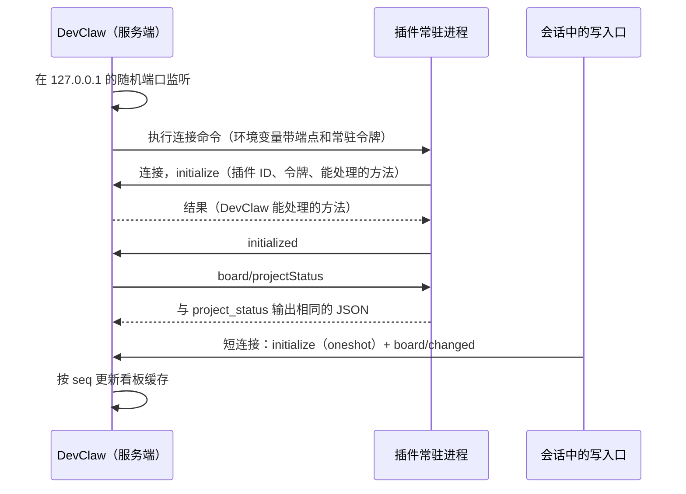

# DevClaw 与插件的 JSON-RPC 双向通信（草案）

现在 DevClaw 通过 `inspectCommands` 调用插件：每次查询、新建都启动一个 Python 进程，单向请求、单次返回；反方向只有看板事件推送（D21，HTTP 通知）。mods 只在会话里运行，接不住会话以外的交互（[mods.md §2.5](mods.md)）。

本文设计一条双向的 JSON-RPC 通道：DevClaw 作服务端；插件通过连接命令启动常驻进程，连上服务端后用插件 ID 注册，之后双方在这条连接上互发请求和通知。

本文是草案，需要 DevClaw 确认的事项见 §11。

## 0. 结论

- **内容仍由 Python 生成**。常驻进程里运行的还是 `runtime/` 下同一份适配代码，只是从“每次启动一个进程”变成“常驻进程里的一次函数调用”，省掉每次启动解释器（空解释器约 34 ms）和导入的时间（[interfaces.md §3.5](interfaces.md)）。请求结果与对应命令的 stdout 完全相同；
- **inspectCommands 保留**，用于兼容和兜底：旧版 DevClaw、常驻进程还没连上或已经退出、插件没有声明某个方法时，DevClaw 照旧执行命令；
- **D21 的推送并入本协议**。消息内容不变，HTTP POST 改为本协议的通知；常驻进程以外的写入口（例如会话中的 `update_state.py`）用短连接发送；
- **连接按插件 ID 绑定**。握手时确定插件 ID，之后这条连接上的消息都属于这个插件，不必每条都带；DevClaw 按插件 ID 路由请求；
- 常驻进程补上了 mods 缺少的“会话以外的常驻部分”（[mods.md §6](mods.md) 第 4 项）：看板读取、新建项目和 Feature 由常驻进程处理，会话里的事仍交给运行 mod。

## 1. 角色与连接

| 角色 | 是谁 | 数量 | 做什么 |
|---|---|---|---|
| 服务端 | DevClaw | 每个 DevClaw 实例一个 | 监听本机端口，验证身份，按插件 ID 路由，缓存看板数据 |
| 常驻连接 | 插件的常驻进程 `runtime/rpc/serve.py`，由连接命令启动 | 每个插件最多一条 | 处理 DevClaw 发来的全部请求；自己执行的写操作提交后发送看板通知；配置变化时通知 DevClaw |
| 短连接 | 常驻进程以外的写入口：会话中的 `update_state.py`、`auto_state.py`（mods.md §2.3），兜底执行的 `init_workspace.py`、`init_feature.py` | 用完即断 | 提交后发送一条通知 |

插件只作客户端，不监听任何端口。



## 2. 传输

| 项 | 约定 | 原因 |
|---|---|---|
| 通道 | TCP，只监听 `127.0.0.1` 或 `::1`，端口随机 | 三个平台都能用；Windows 上 Python 对 Unix 域套接字的支持不完整 |
| 分帧 | LSP 基础协议：`Content-Length: <字节数>\r\n\r\n<JSON>`，只认这一个头，JSON 为 UTF-8 | Node 端有现成实现（例如 `vscode-jsonrpc`）；Python 用标准库 `socket` 几十行就能实现 |
| 消息 | JSON-RPC 2.0，不支持批量（数组） | 简化两端实现 |
| 大小 | 单条消息不超过 32 MiB，超过时断开连接 | `session/context` 带知识段时可能较大 |
| 发现 | 环境变量 `AUTOBIZ_RPC_ENDPOINT`，形如 `tcp://127.0.0.1:53817` | 取代 D21 的 `AUTOBIZ_BOARD_ENDPOINT` |

不用 WebSocket：Python 标准库没有 WebSocket 客户端，而运行时只依赖标准库（[README §1](README.md)）。不用 LSP、MCP 那样由 DevClaw 启动子进程、经 stdin/stdout 通信的方式：短连接的写入口运行在会话里，不是 DevClaw 的子进程，需要一个固定能找到的地址；服务端放在 DevClaw，常驻进程和短连接就都连同一个地址。

## 3. 身份与安全

**令牌**：DevClaw 每次启动时，为每个插件生成两个随机令牌（至少 128 位）：

| 令牌 | 注入到 | 允许的角色 |
|---|---|---|
| 常驻令牌 | 只注入连接命令的环境变量 | `resident` |
| 客户端令牌 | 该插件发起的会话、该插件的 inspectCommands | `oneshot` |

两个令牌都通过环境变量 `AUTOBIZ_RPC_TOKEN` 传递，不放在命令行参数里（`ps` 能看到命令行）。分成两个，是因为会话里的命令由模型执行，不能让它冒充常驻进程、接管 DevClaw 发来的请求。同样的原因，常驻进程执行校验命令、自定义会话入口时，要从子进程的环境变量中去掉 `AUTOBIZ_RPC_TOKEN`。

**插件 ID**：取 `plugin.id`。DevClaw 从 board_config 新增的 `rpc.pluginId` 读到它（§9），并记录为每个插件生成的令牌。握手时检查：

1. 连接后 5 秒内第一条消息必须是 `initialize`，否则断开；
2. `pluginId` 是 DevClaw 已加载的插件，令牌与该插件、该角色对应（常量时间比较）；
3. `pluginPath` 的 realpath 与 DevClaw 加载的插件目录一致，用来区分同一插件 ID 的开发挂载和安装版本；
4. 角色为 `resident` 时，该插件当前没有在线的常驻连接。DevClaw 要替换常驻进程时，先断开旧连接再启动新进程。

任何一项不通过，返回错误（§4.3）并断开。握手之后，连接上的消息都属于这个插件；消息参数中出现的 `pluginId` 与连接的不一致时，按鉴权失败处理。

**范围**：端点只接受回环地址和显式端口（同 D21）；DevClaw 只处理 §5 列出的方法，没有执行任意命令的方法。令牌防的是浏览器跨站请求和其他插件冒充，防不了同一用户下能读取 DevClaw 子进程环境变量的进程，这与现有的信任边界一致。

## 4. 消息约定

### 4.1 命名与参数

- 方法名为 `<领域>/<动作>`，动作用小驼峰，例如 `board/featureStatus`；协议层的方法以 `$/` 开头（同 LSP）；
- 参数为对象，字段用小驼峰，路径一律为绝对路径；
- 宿主占位符（[interfaces.md §3.2](interfaces.md)）对应的参数：`workspace`（`${pluginWorkspace}`）、`project`（`${projectDir}`）、`projects`（`${projectDirs...}`，数组）、`feature`、`selectedDeployUnits`（JSON 数组本身，不再是字符串）、`sessionWorkspacePath`、`platform`。

### 4.2 结果

**请求的结果与对应命令的 stdout 完全相同**，包括 `ok` 字段。业务失败（命令以 1 退出、stdout 为 `{"ok": false, "errors": […]}`）照样作为结果返回，不转成 JSON-RPC 错误。这样：

- DevClaw 对两种调用方式用同一套处理逻辑；
- 契约测试对同一组输入比较命令输出和 RPC 结果，必须逐字段相等。

### 4.3 错误

JSON-RPC 错误只用于协议和系统层面的失败：

| code | 含义 |
|---|---|
| -32700、-32600、-32601、-32602、-32603 | JSON-RPC 标准：解析失败、请求无效、方法不存在、参数无效、内部错误（插件端未捕获的异常，`data.traceback` 截取末尾 2000 个字符） |
| -32002 | 未初始化：`initialize` 之前发送了其他消息 |
| -32010 | 鉴权失败：令牌、插件 ID 或插件目录不匹配 |
| -32011 | 该插件已有在线的常驻连接 |
| -32012 | 协议主版本不兼容 |
| -32800 | 请求已取消（同 LSP） |

收到 -32601、-32603 或请求超时，DevClaw 对这一次请求改用 inspectCommands。

### 4.4 并发、超时与取消

- 双方都可以同时有多个未完成的请求，结果可以乱序返回，按 `id` 对应；
- 常驻进程用线程池处理请求（默认 4 个线程）。状态写入的互斥仍由 engine 的 `.state.lock` 保证，与其他进程（例如会话中的 `update_state.py`）之间也是如此；
- 超时由发起方决定。DevClaw 的默认值：看板读取 10 秒，新建 30 秒，`session/context` 为 30 秒加自定义会话入口的超时，`knowledge/pull` 300 秒。超时后发送 `$/cancelRequest`；
- `$/cancelRequest {"id": …}`：只读请求收到后尽快停止，返回 -32800；写请求一旦进入 engine 的锁就会执行完，结果照常返回。

## 5. 方法

### 5.1 握手与关闭

**`initialize`**（插件 → DevClaw，请求）：

```json
{ "jsonrpc": "2.0", "id": 1, "method": "initialize", "params": {
    "protocolVersion": "1.0",
    "role": "resident",
    "pluginId": "doc-review",
    "pluginPath": "/abs/plugins/doc-review",
    "pluginVersion": "1.2.0",
    "coreVersion": "1.0.0",
    "token": "…",
    "pid": 12345,
    "capabilities": { "methods": ["board/projectStatus", "board/featureStatus", "…"] } } }
```

```json
{ "jsonrpc": "2.0", "id": 1, "result": {
    "protocolVersion": "1.0",
    "serverInfo": { "name": "devclaw", "version": "…" },
    "capabilities": { "methods": [],
                      "notifications": ["board/changed", "plugin/configChanged", "plugin/restartRequired", "$/progress"] } } }
```

- `role`：`resident` 或 `oneshot`；
- `capabilities.methods`：本端能处理的请求。DevClaw 只向常驻进程发送它声明过的方法，其余走 inspectCommands；插件也只向 DevClaw 发送对方声明过的方法和通知；
- `protocolVersion`：主版本不同时 DevClaw 返回 -32012，插件退出，DevClaw 改用 inspectCommands；次版本不同时按 `capabilities` 协商。

常驻连接收到结果后发送 `initialized` 通知，DevClaw 从这时起把该插件标为“在线”，开始向它发送请求。

**`shutdown`**（DevClaw → 插件，请求）：常驻进程不再接受新请求，等进行中的请求完成后返回 `null`。随后 DevClaw 发送 **`exit`** 通知，插件断开连接并退出。

### 5.2 DevClaw → 插件（常驻连接）

| 方法 | 对应的 inspectCommand | 参数 | 结果 |
|---|---|---|---|
| `board/projectStatus` | `project_status` | `workspace`、`projects` | [interfaces.md §3.3.3](interfaces.md) |
| `board/featureStatus` | `feature_status` | `workspace`、`project`、`feature` | §3.3.4 |
| `workflow/templates` | `dynamic_workflow` | 无 | §3.3.5 |
| `project/create` | `create_project` | `workspace`、`project` | §3.3.1 |
| `feature/create` | `create_feature` | `workspace`、`project`、`feature`、`selectedDeployUnits`，可选 `workflowTemplate`、`owner`、`iteration` | §3.3.2 |
| `session/context` | `session_context_inject` | `platform`、`workspace`、`project`、`feature`、`selectedDeployUnits`、`sessionWorkspacePath` | §3.3.7 |
| `knowledge/deployUnits` | `deploy_units` | 可选 `system` | §3.3.8 |
| `knowledge/pull` | `pull_knowledge` | 可选 `progressToken` | §3.3.9；进行中发送 `$/progress` |
| `state/update` | 无（新增） | `workspace`、`project`、`feature`、`checkpoint`，可选 `reopen`、`reason`、`owner`、`iteration`、`dryRun` | 与 `update_state.py` 的输出相同（§4.2）。供看板上的人工操作使用，例如重开；人工关口（mods.md §2.3）定稿后再增加参数 |

`system_prompt_inject`、`dialog_tips`、`plugin_dir_hook`、`knowledge_path` 是模板字符串，DevClaw 直接从 board_config 读取，不经过 RPC。

`project/create`、`feature/create`、`state/update` 使状态实际改变时，常驻进程在释放锁之后，在同一条连接上发送 `board/changed`（§5.3）。

### 5.3 插件 → DevClaw

| 方法 | 类型 | 谁发送 | 说明 |
|---|---|---|---|
| `board/changed` | 通知 | 常驻进程；短连接 | 参数与 [interfaces.md §3.5.2](interfaces.md) 的 `params` 相同，DevClaw 按 §3.5.4、§3.5.5 处理 |
| `plugin/configChanged` | 通知 | 常驻进程 | 发现 `build-manifest.json` 变化并重读配置后发送，参数 `{"manifestDigest": "…"}`。DevClaw 重读 board_config，清空该插件的看板缓存 |
| `plugin/restartRequired` | 通知 | 常驻进程 | 发现 `runtime/` 下的托管代码变了（框架升级），参数 `{"reason": "…"}`。发送后等进行中的请求完成就退出，由 DevClaw 重启 |
| `$/progress` | 通知 | 常驻进程 | `{"token": …, "message": "…", "percent": 40}`，用于 `knowledge/pull` |
| `$/cancelRequest` | 通知 | 双方 | §4.4 |

后续可以增加的插件 → DevClaw 请求（v1 不做，由 `capabilities` 协商）：

| 方法 | 用途 | 关联 |
|---|---|---|
| `workspace/listProjects` | 列出使用了本插件的项目，用于开发态的影响分析 | [mods.md §4.5](mods.md)、§6 第 9 项 |
| `ui/notify` | 在 DevClaw 中弹出提示，例如知识同步完成、流程已更新 | mods.md §2.4 |

## 6. 常驻进程的生命周期

### 6.1 连接命令

board_config 的 `inspectCommands.<platform>` 新增 `connect`：

```text
{py} "${pluginPath}/runtime/rpc/serve.py"
```

`{py}` 的取法同 [output-spec.md §3.2](output-spec.md)。DevClaw 执行时注入 `AUTOBIZ_RPC_ENDPOINT` 和常驻令牌 `AUTOBIZ_RPC_TOKEN`；工作目录不保证（同 [interfaces.md §3.1](interfaces.md)）。

### 6.2 启动与停止

| 时机 | DevClaw 的处理 |
|---|---|
| 第一次需要 | 第一次要调用该插件时（通常是显示看板）启动；连上之前的请求走 inspectCommands |
| 空闲 | 一段时间没有请求后（建议 10 分钟，由 DevClaw 决定）发送 `shutdown`，下次需要时再启动 |
| 插件停用、卸载，DevClaw 退出 | `shutdown`，然后 `exit`；5 秒后仍未退出就结束进程（Windows 上结束整个进程树） |
| 插件升级、重新安装 | 先停旧进程，再按需启动新进程 |
| 收到 `plugin/restartRequired` | 等它退出后立即重启 |
| 意外退出或断开 | 按 1、2、4 秒……最长 30 秒退避重启；3 分钟内失败 5 次就停止重启，该插件改用 inspectCommands，并在 DevClaw 中显示原因 |

常驻进程这一侧：连接断开（包括 DevClaw 崩溃）就退出，不重连，不留下孤儿进程；不使用 stdout，stderr 作为日志由 DevClaw 收集。

### 6.3 配置与代码变化

- **配置**（编译配置、技能、模板、校验脚本）：常驻进程处理每个请求之前比对 `build-manifest.json`（先看修改时间和大小，变了再算摘要），有变化就重读编译配置；空闲时每 2 秒检查一次，发现变化后发送 `plugin/configChanged`。与运行 mod 的 R3 规则相同（[mods.md §4.4](mods.md)）：manifest 中的摘要与文件对不上时（build 提交到一半），继续用旧配置；
- **代码**（`runtime/` 下的托管文件、`coreVersion` 变化）：Python 不能安全地重新加载已导入的模块，所以发送 `plugin/restartRequired` 后退出，由 DevClaw 重启。

开发态改完核心配置、自动 build 之后，DevClaw 通过 `plugin/configChanged` 得知变化，不需要自己监视插件目录（mods.md §6 第 2 项的一部分）。

## 7. 短连接

| 项 | 规则 |
|---|---|
| 谁 | 常驻进程以外的写入口（§1），在提交之后连接 |
| 端点与令牌 | 从环境变量读取。DevClaw 在该插件发起的会话、执行的 inspectCommands 中注入 `AUTOBIZ_RPC_ENDPOINT` 和客户端令牌；未设置时静默跳过 |
| 过程 | 连接后连续写出 `initialize`（`role: "oneshot"`）和 `board/changed`，不等 `initialize` 的结果；读到 `initialize` 的结果或超时后断开。DevClaw 按顺序处理，`initialize` 失败时丢弃后续消息 |
| 时机 | 释放 `.state.lock` 之后，不能持锁发网络请求 |
| 超时与失败 | 总共 300 毫秒，只尝试一次，不重试。失败只在 stderr 写一行警告，不影响命令的 stdout、退出码和 `warnings` |
| 实现 | 只用标准库 `socket`，只在设置了端点时才导入（同 D21） |

运行 mod 不直接连接 DevClaw：它调用的 `auto_state.py` 是写入口，提交后自己发送通知。mods.md R6 的看板刷新因此不再依赖 DevClaw 给 mod 提供看板接口。

## 8. 插件端实现

```text
runtime/
├── rpc/
│   ├── serve.py       # managed  连接命令的入口：连接、握手、分发请求、检查配置变化
│   └── client.py      # managed  分帧与短连接发送；取代 adapters/board_events.py
└── adapters/…         # managed  每个入口拆成 handle(params) 和命令行解析两层
```

- 每个框架入口拆成两层：`handle(params) -> dict` 返回结果对象；`main()` 只解析命令行参数、调用 `handle`、输出 JSON。`serve.py` 的方法表直接映射到这些 `handle`，命令和 RPC 走的是同一份代码；
- 启动时预先导入 `query`、`engine` 和各适配器，第一个请求不用等导入；
- 一个读线程负责接收和分帧，请求交给线程池，发送时加锁，保证帧不交错；
- 业务异常按 `common/cli.py` 的规则转成 `{"ok": false, "errors": […]}`；其他未捕获的异常转成 -32603，进程不退出；
- 契约测试（`tests/contract/`）增加一个模拟的 DevClaw 服务，覆盖：握手和鉴权的各种失败、方法结果与命令输出一致、`board/changed` 的 `seq` 依次递增、取消和超时、断开后进程退出、DevClaw 不在时写入口照常完成。

## 9. 兼容与降级

board_config 的顶层键 `boardEvents` 改为 `rpc`：

```json
"rpc": { "protocol": "autobiz.rpc.v1", "pluginId": "doc-review" }
```

DevClaw 据此知道插件支持本协议，并取得插件 ID。

| 情况 | 处理 |
|---|---|
| DevClaw 不支持本协议 | 忽略 `rpc` 和 `connect`，照旧执行 inspectCommands；写入口找不到端点，静默跳过推送 |
| 插件没有 `rpc` 键（旧插件） | DevClaw 照旧执行 inspectCommands |
| 常驻进程还没连上、正在重启或已停止重启 | 逐个请求改用 inspectCommands |
| 插件没有声明某个方法 | 该方法改用 inspectCommands |
| 请求超时，或返回 -32601、-32603 | 本次请求改用 inspectCommands |

因此 inspectCommands 必须一直生成，并且与 RPC 方法保持一致。

## 10. 对现有设计的影响

| 位置 | 改动 |
|---|---|
| D21、[interfaces.md §3.5](interfaces.md) | 通道由 HTTP POST 改为本协议的 `board/changed` 通知，消息内容（§3.5.2）、顺序规则（§3.5.4）和 DevClaw 的处理规则（§3.5.5）不变；§3.5.1 的通道与发现、§3.5.3 中的“实现”改为本文 §2、§7；§3.5.6 中的鉴权由本文 §3 实现 |
| [interfaces.md §3.1](interfaces.md) | 增加：同一个方法既可以通过命令调用，也可以通过 RPC 调用，结果相同 |
| [interfaces.md §3.4](interfaces.md) | `AUTOBIZ_BOARD_ENDPOINT` 改为 `AUTOBIZ_RPC_ENDPOINT`，新增 `AUTOBIZ_RPC_TOKEN` |
| [interfaces.md §4.1、§4.3](interfaces.md) | 新增入口 `runtime/rpc/serve.py`，各入口拆出 `handle`；常驻进程执行单行命令时不继承 `AUTOBIZ_RPC_TOKEN` |
| [output-spec.md §1](output-spec.md) | 新增 `runtime/rpc/`；`adapters/board_events.py` 由 `rpc/client.py` 取代 |
| [output-spec.md §3.1、§3.2](output-spec.md) | `boardEvents` 改为 `rpc`（带 `pluginId`）；`inspectCommands` 新增 `connect` |
| [mods.md](mods.md) | R6 的看板刷新改为由写入口发送 `board/changed`；§6 第 3 项不再需要，第 4 项要解决的会话外常驻部分由常驻进程承担；A5 开发挂载后的变化由 `plugin/configChanged` 通知 DevClaw |
| [README §1](README.md) | “看板事件推送”一条改为本协议 |

## 11. 需要 DevClaw 确认

1. DevClaw 侧能否直接使用 LSP 分帧的 JSON-RPC 库（例如 `vscode-jsonrpc`）；
2. 进程管理由 DevClaw 实现：按需启动、空闲停止、退避重启、结束进程树。每个启用的插件最多一个常驻 Python 进程，内存占用待实测；
3. 令牌注入：连接命令注入常驻令牌；该插件发起的会话和执行的 inspectCommands 注入客户端令牌；
4. DevClaw 现在用什么标识插件（目录、`plugin.json` 的 `name`），能否改为从 `rpc.pluginId` 取得插件 ID 并按它路由；同一个插件 ID 同时有开发挂载和安装版本时怎么处理；
5. 同一台机器开多个 DevClaw 实例时，各自启动常驻进程。两个进程写同一个 `state.json` 由 engine 的锁保证，但会话中的写入口只通知发起会话的那个实例，另一个实例的看板要等下次拉取才更新，是否可以接受；
6. v1 是否需要插件 → DevClaw 的请求（`workspace/listProjects`、`ui/notify`），需要的话 DevClaw 提供哪些；
7. 旧版 DevClaw 能否忽略 board_config 中未知的顶层键 `rpc` 和 `inspectCommands` 中未知的 `connect`（与原来 `boardEvents` 的问题相同，[README §9](README.md) 第 10 项）。

## 12. 不做

- 插件监听端口、DevClaw 作客户端：插件一多，就需要多个端口和额外的发现机制；
- 用 RPC 传模板字符串（`system_prompt_inject` 等）：它们是静态配置，留在 board_config；
- 在常驻进程内热重载 Python 代码：代码变化一律重启进程；
- 去掉 inspectCommands：兼容旧版 DevClaw 和兜底都需要它。
